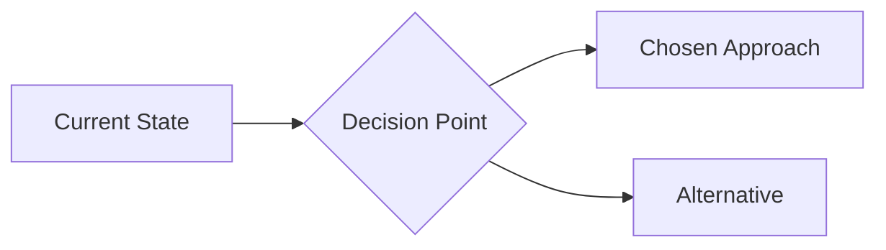

<!-- Prepend the branded header from .ai/templates/artifact-header.md before this content. -->
# ADR-[number]: [Decision Title]

**Date:** [YYYY-MM-DD]  
**Status:** [Proposed | Accepted | Superseded | Deprecated]  
**Deciders:** [Agent or team member who decided]

## Context
[What is the situation forcing this decision?]

_Replace with a diagram showing the context or chosen design. Delete if no diagram is needed._

## Decision
[What are we doing?]

## Rationale
[Why this option over alternatives?]

## Consequences
**Positive:**
- [Benefit 1]

**Negative / Trade-offs:**
- [Trade-off 1]

**Risks:**
- [Risk 1]
