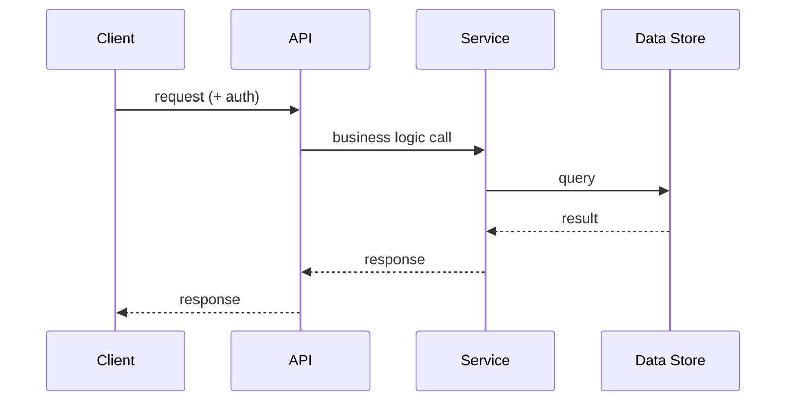

<!-- Prepend the branded header from .ai/templates/artifact-header.md before this content. -->
# Technical Specification: [Feature Name]

## Overview
[2-3 sentences describing what this spec covers]

## Problem Statement
[What problem are we solving and why now?]

## Proposed Solution
[High-level description of the approach]

## Architecture Diagram

_Replace with a diagram relevant to this feature. Delete this section if no diagram adds clarity._

## Technical Design
### Data Model Changes
### API Changes
### Component/Module Changes
### External Integrations

## Alternatives Considered
[What other approaches were evaluated and why they were rejected]

## Security Considerations
[Any security implications]

## Performance Considerations
[Expected load, any performance implications]

## Testing Plan
[How this will be tested — unit, integration, e2e]

## Rollout Plan
[How to deploy safely — feature flags, phased rollout, etc.]

## Open Questions
[Any unresolved decisions]
