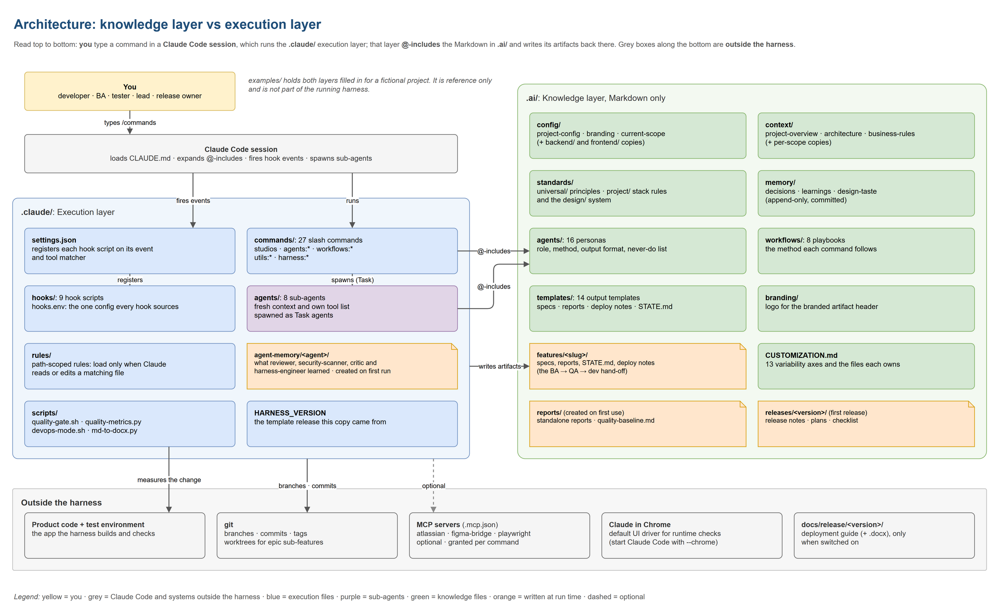
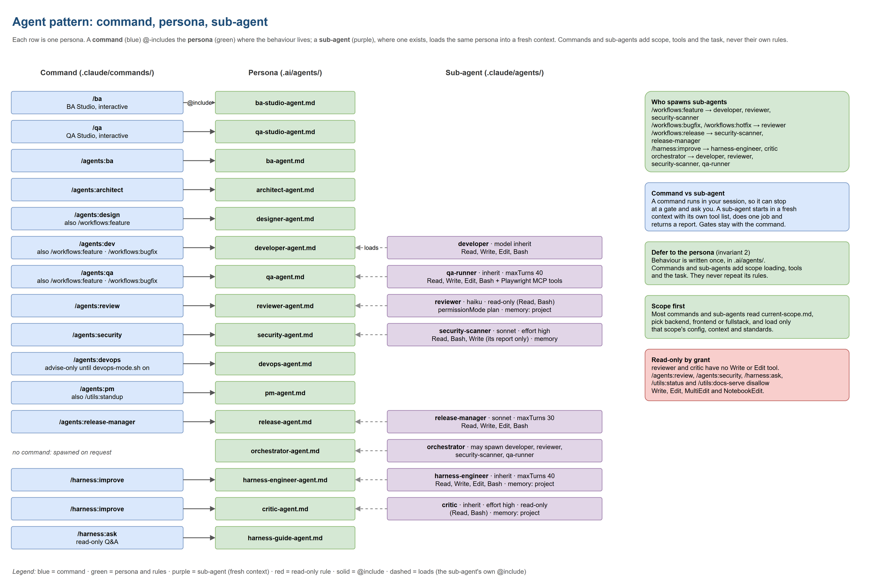
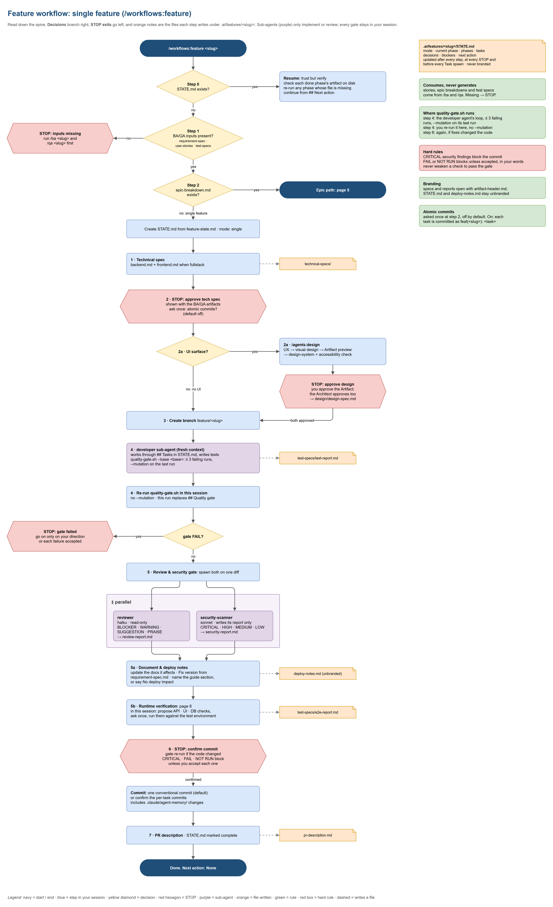
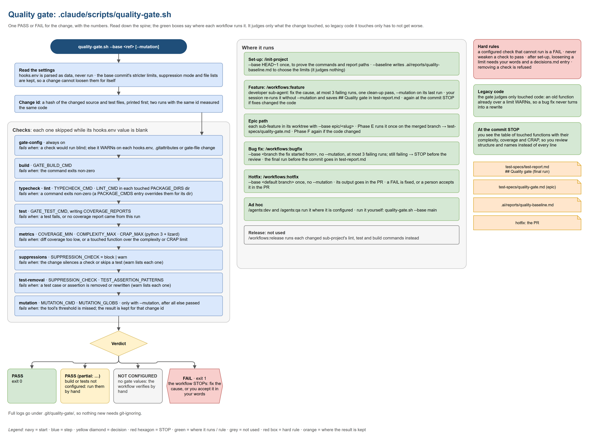
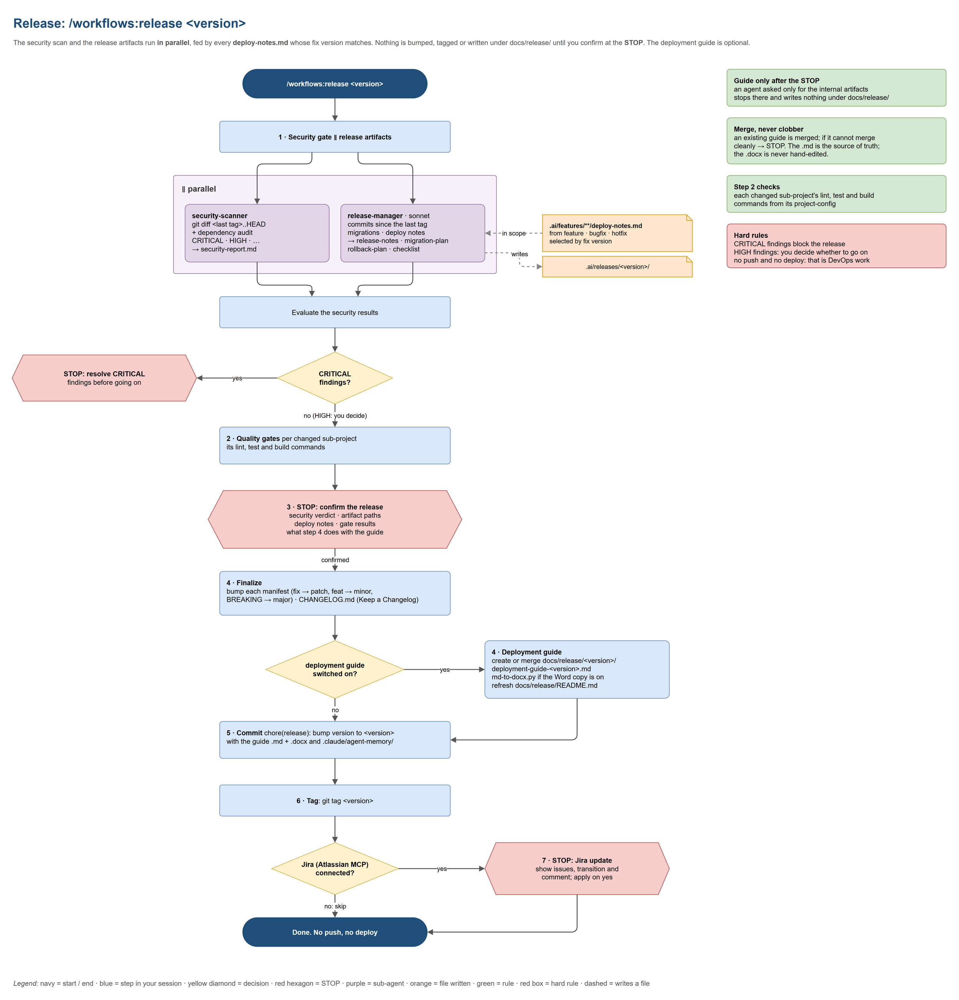
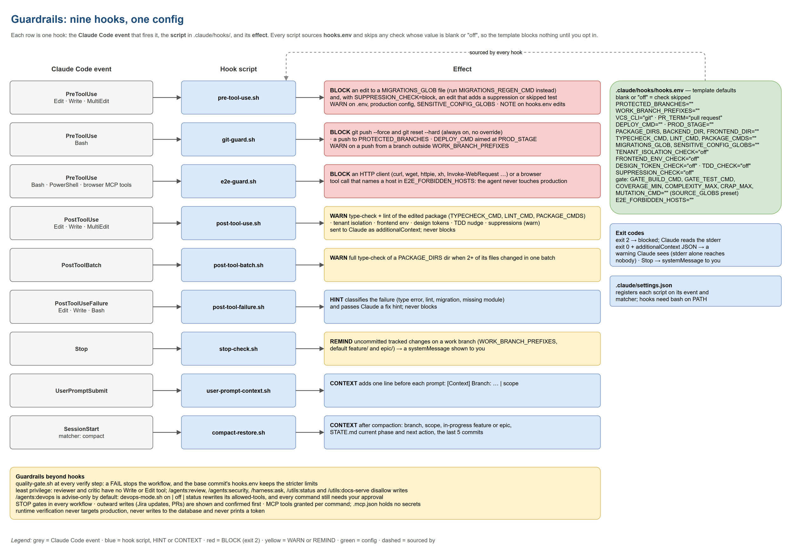
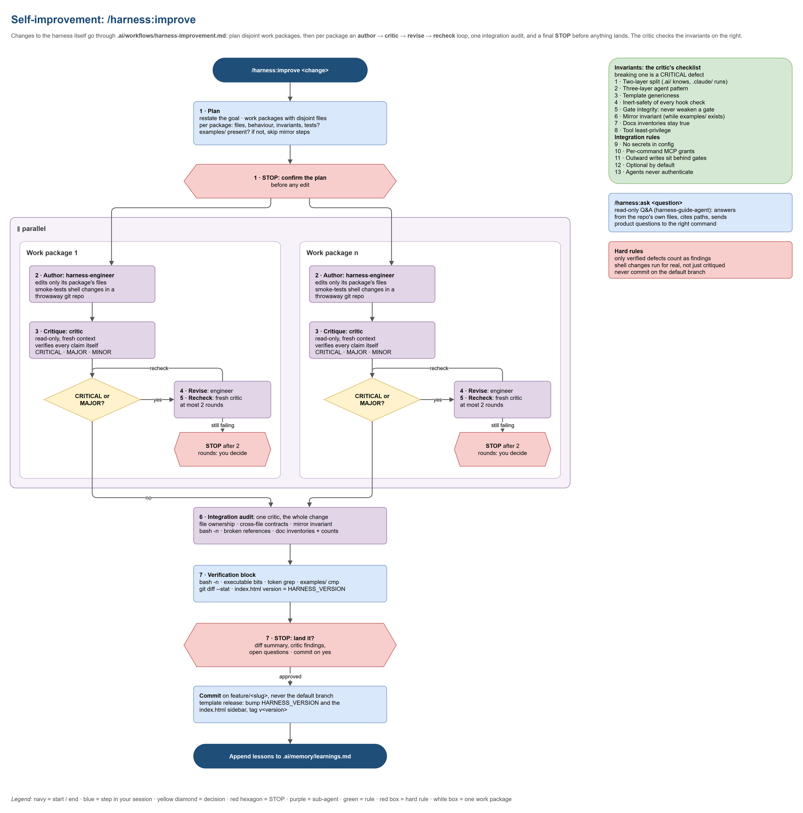

# How the AI Dev Harness works

The AI Dev Harness sits on top of Claude Code and takes work from a requirement to a pull request.
It has a specialist agent for each role, shared project knowledge in Markdown, workflows that stop
for your approval at set points, and guardrails: hooks that block or warn on risky actions, and a
quality gate that measures each change. Each part of the system has a diagram below.

The guide is for developers, business analysts, testers, tech leads and release owners who use the
harness in a project, and for whoever maintains the harness. The knowledge layer lives in
[`.ai/`](../../.ai/README.md), the execution layer in [`.claude/`](../../.claude/README.md), and the
full command list in [`COMMANDS.md`](../../COMMANDS.md). For one entry per component, see
[`../components.md`](../components.md). All the diagrams come from one multi-page draw.io file,
[`diagrams/ai-dev-harness/ai-dev-harness.drawio`](diagrams/ai-dev-harness/ai-dev-harness.drawio)
(see [Updating the diagrams](#updating-the-diagrams)).

## Contents

1. [Architecture: knowledge and execution layers](#1-architecture-knowledge-and-execution-layers)
2. [Agent pattern: command, persona and sub-agent](#2-agent-pattern-command-persona-and-sub-agent)
3. [End-to-end delivery lifecycle](#3-end-to-end-delivery-lifecycle)
4. [Feature workflow (`/workflows:feature`)](#4-feature-workflow-workflowsfeature)
5. [Epic path, phases A to F](#5-epic-path-phases-a-to-f)
6. [Bug fix (`/workflows:bugfix`)](#6-bug-fix-workflowsbugfix)
7. [Hotfix (`/workflows:hotfix`)](#7-hotfix-workflowshotfix)
8. [Runtime verification (`/workflows:verify`)](#8-runtime-verification-workflowsverify)
9. [Quality gate (`quality-gate.sh`)](#9-quality-gate-quality-gatesh)
10. [Release (`/workflows:release`)](#10-release-workflowsrelease)
11. [Hooks and guardrails](#11-hooks-and-guardrails)
12. [Changing the harness (`/harness:improve`)](#12-changing-the-harness-harnessimprove)
13. [Concepts that apply everywhere](#13-concepts-that-apply-everywhere)
14. [Which command do I use?](#14-which-command-do-i-use)
15. [Updating the diagrams](#updating-the-diagrams)

## 1. Architecture: knowledge and execution layers



You type a slash command in a Claude Code session. The session runs files from `.claude/`, and
those files pull in the Markdown in `.ai/` through `@`-includes. Once `/init-project` has filled in
`.ai/` for a project, the same commands work there without changes.

| Layer | Folder | Holds | Executes? |
|---|---|---|---|
| Knowledge | `.ai/` | Personas, workflow playbooks, standards, templates, project config and context, memory, and the artifacts each feature produces | No. It is Markdown that agents read |
| Execution | `.claude/` | Slash commands, sub-agents, hooks and `hooks.env`, `settings.json`, helper scripts, path-scoped rules, `HARNESS_VERSION` | Yes. Claude Code runs it |
| Root files | `CLAUDE.md`, `AGENTS.md`, `COMMANDS.md`, `.mcp.json` | Per-session guidance, the method for non-Claude agents, the command list, the MCP servers | `CLAUDE.md` is loaded into every session |

The knowledge layer (`.ai/`):

| Path | Purpose |
|---|---|
| [`.ai/agents/`](../../.ai/agents) | 16 personas: each role's responsibilities, method, output format and never-do list |
| [`.ai/workflows/`](../../.ai/workflows) | 8 playbooks, one for each workflow command's method |
| [`.ai/standards/universal/`](../../.ai/standards/universal) | Portable principles: coding, API design, security baseline, testing, accessibility, UI/UX, frontend design, git workflow |
| [`.ai/standards/project/`](../../.ai/standards/project) | Your stack's rules (`tech-specific.md`) and the design system under `frontend/design/`; the per-stack folders are reference only |
| [`.ai/templates/`](../../.ai/templates) | 14 output templates, from `technical-spec.md` to `feature-state.md` |
| [`.ai/config/`](../../.ai/config) | `project-config.md` (stack, commands, test environments, release deliverables), `branding.md`, `current-scope.md`, plus per-scope copies |
| [`.ai/context/`](../../.ai/context) | `project-overview.md`, `architecture.md`, `business-rules.md`, plus per-scope copies |
| [`.ai/memory/`](../../.ai/memory) | `decisions.md`, `learnings.md`, `design-taste.md`; append-only and committed |
| [`.ai/features/`](../../.ai/features) | One folder per feature slug with its specs, reports, `STATE.md` and `deploy-notes.md` |
| [`.ai/CUSTOMIZATION.md`](../../.ai/CUSTOMIZATION.md) | The 13 variability axes and the files and tokens each one owns |
| `.ai/reports/`, `.ai/releases/<version>/` | Created on first use: standalone reports, `quality-baseline.md`, and each release's internal artifacts |

The execution layer (`.claude/`):

| Path | Purpose |
|---|---|
| [`.claude/commands/`](../../.claude/commands) | 27 slash commands: the studios (`/init-project`, `/ba`, `/qa`) and the `agents:`, `workflows:`, `utils:` and `harness:` families |
| [`.claude/agents/`](../../.claude/agents) | 8 sub-agents, each with its own context window, tool list and model |
| [`.claude/hooks/`](../../.claude/hooks) | 9 hook scripts and [`hooks.env`](../../.claude/hooks/hooks.env), the one config they all read |
| [`.claude/settings.json`](../../.claude/settings.json) | Registers each hook on its event and tool matcher |
| [`.claude/scripts/`](../../.claude/scripts) | `quality-gate.sh` and its engine `quality-metrics.py`, `devops-mode.sh`, `md-to-docx.py` |
| [`.claude/rules/`](../../.claude/rules) | Path-scoped rules that load only when Claude reads or edits a matching file |
| [`.claude/HARNESS_VERSION`](../../.claude/HARNESS_VERSION) | The template release a project was set up from |
| `.claude/agent-memory/<agent>/` | Created on first run by the four sub-agents with `memory: project`; committed with the workflows' changes |

The `examples/` folder has both layers filled in for a fictional project. Use it to see what a
configured file looks like; the running harness never reads it.

[`.mcp.json`](../../.mcp.json) ships three optional MCP servers: `atlassian` (remote, OAuth, with no
secret in the file), and `figma-bridge` and `playwright`, both started with `npx`. You authenticate
once with `/mcp`. Each command gets only the tools it needs: `/ba` can take a Jira issue key as its
input, `/agents:pm` and `/utils:standup` (both load `pm-agent.md`) can pull status from Jira, and
`/workflows:release` can transition released Jira issues after a STOP. UI checks use Claude in Chrome
by default (start Claude Code with `--chrome`), then Playwright MCP, then the project's e2e command.
`/init-project` can add an optional read-only database MCP server. When a server isn't connected, the
harness falls back to the manual path, and a check that can't run is reported as NOT RUN.

## 2. Agent pattern: command, persona and sub-agent



An agent is defined in up to four places:

1. The persona, `.ai/agents/<name>-agent.md`, holds the behaviour: responsibilities, method, output
   format and what never to do. You can't run a persona on its own.
2. A command under `.claude/commands/` `@`-includes the persona plus the standards, templates or
   playbook it needs, and adds scope detection, the `allowed-tools` line and the task. You run it as
   `/name <arguments>`.
3. A sub-agent, `.claude/agents/<name>.md`, loads the same persona with an `@`-include and sets its
   own `tools`, `model`, `effort`, `maxTurns` and `memory`. Workflow commands spawn it as a Task agent
   with a fresh context; you never type a sub-agent's name.
4. The `orchestrator` sub-agent may delegate to `developer`, `reviewer`, `security-scanner` and
   `qa-runner` (its `tools` line). No command spawns it.

Behaviour is written once, in the persona. `/agents:review` and the `reviewer` sub-agent both load
`reviewer-agent.md`, which owns the review method and the BLOCKER / WARNING / SUGGESTION / PRAISE
vocabulary. The sub-agent file adds only scope loading, its memory folder and the output it returns,
so editing the persona changes both paths. This is invariant 2 in
[`harness-improvement.md`](../../.ai/workflows/harness-improvement.md).

Some commands load a playbook instead of a persona: `/workflows:hotfix` loads `hotfix-process.md`,
`/workflows:release` loads `release-process.md` and `/workflows:verify` loads
`runtime-verification.md`. Most utilities load nothing.

Sub-agent settings worth knowing:

- `reviewer` runs on `model: haiku` with `permissionMode: plan` and only the `Read` and `Bash`
  tools. It saves its report through Bash and has no Write or Edit tool for the project.
- `critic` uses `model: inherit` and `effort: high` with `Read` and `Bash`. It is read-only, and its
  job is to break proposed harness changes.
- `security-scanner` runs on `model: sonnet` with `effort: high` and `Read`, `Bash` and `Write`. It
  writes only the report it is asked for.
- `release-manager` runs on `model: sonnet` with `maxTurns: 30`.
- `qa-runner` has the Playwright MCP browser tools. It turns down runtime verification, which runs in
  your session.
- `reviewer`, `security-scanner`, `critic` and `harness-engineer` have `memory: project`. Each keeps
  `.claude/agent-memory/<agent>/MEMORY.md`, reads it before starting and ends with a `Memory:` line.
- `/agents:review`, `/agents:security`, `/harness:ask`, `/utils:status` and `/utils:docs-serve` are
  read-only: they set `disallowed-tools: Write, Edit, MultiEdit, NotebookEdit`.

## 3. End-to-end delivery lifecycle


The standard path for a ticket:

```text
Jira issue (key + Fix version)      → read through the Atlassian MCP server when it is connected
/ba <slug>                    → requirement-spec.md (with Fix version), user-stories.md, epic-breakdown.md for an epic
/qa <slug>                    → test-specs.md (one per sub-feature for an epic)
/workflows:feature <slug>     → STATE.md, technical-specs/, design/design-spec.md, test-specs/test-report.md
                                (with ## Quality gate), test-specs/quality-gate.md for an epic, review-report.md,
                                security-report.md, deploy-notes.md, test-specs/e2e-report.md, pr-description.md
  … pull request: you open it from pr-description.md (the epic path opens it after a STOP);
    a person reviews and merges …
/workflows:release <version>  → .ai/releases/<version>/ (release notes, migration plan, rollback plan,
                                deployment checklist, security report), CHANGELOG.md, git tag,
                                docs/release/<version>/ deployment guide if switched on
  … deploy: people or CI; the agent never deploys and is blocked from production hosts …
```

How the stages connect:

- People make the decisions. `/ba` and `/qa` are interviews. `/workflows:feature` stops at the spec,
  the design (UI only) and the commit. `/workflows:release` stops on a CRITICAL finding, before it
  finalizes, and before any Jira update. People review and merge the pull request and run the deploy.
- The quality gate (section 9) runs inside the feature, epic, bug fix and hotfix workflows. Its final
  run is kept in `test-specs/test-report.md`, in `test-specs/quality-gate.md` for an epic, and in the
  PR for a hotfix. The release doesn't run it; it runs each changed sub-project's lint, test and
  build commands instead.
- `/workflows:feature` never writes stories, epic breakdowns or test specs. Those come from `/ba` and
  `/qa`, and if they are missing the workflow stops and tells you to run them.
- Everything for a feature lands under `.ai/features/<slug>/`, so BA, QA and development hand work
  to each other through that one folder.
- `/ba` records the Fix version in the spec's `## Source issue` block, taking it from Jira, from you,
  or writing `unknown — to be confirmed`. Each change copies it into `deploy-notes.md`.
- Feature, bug fix and hotfix each write `deploy-notes.md`, even when nothing needs deploying.
  `/workflows:release` picks them up by Fix version.
- Every document except `STATE.md` and `deploy-notes.md` opens with the header from
  `.ai/templates/artifact-header.md`.

There are other ways in. `/agents:dev "<change>"` makes a quick change without studio specs; it runs
the quality gate where one is configured, and you can check the result with `/workflows:verify`. Any
single specialist is available under `/agents:*`. For fixes, `/workflows:bugfix` commits and leaves
the PR to you, and `/workflows:hotfix` opens a PR into the default branch. `/harness:ask` and
`/harness:improve` work on the harness itself, and the `/utils:*` commands work at any time.

## 4. Feature workflow (`/workflows:feature`)



The command is [`.claude/commands/workflows/feature.md`](../../.claude/commands/workflows/feature.md)
and the playbook is [`.ai/workflows/feature-development.md`](../../.ai/workflows/feature-development.md).

When you run it:

- It picks the single or epic path from what `/ba` wrote. If `epic-breakdown.md` exists, it takes the
  epic path (section 5); it doesn't re-analyse your request.
- It stops for you when the BA or QA inputs are missing; at step 2, to approve the technical spec and
  answer one question (per-task atomic commits, off by default); at step 2a, for UI features, to
  approve the design Artifact, which the Architect approves too; at step 4, if the quality gate still
  fails; and at step 6, to confirm the commit.
- The developer sub-agent implements the `## Tasks` checklist in `STATE.md` and writes the tests and
  the test report. The reviewer and security-scanner sub-agents then run in parallel on the same
  diff. Every gate stays in your session.
- The developer agent runs `.claude/scripts/quality-gate.sh --base <base-branch>` in a loop (section
  9): it fixes the cause each time, stops after 3 failing runs, and adds `--mutation` on its last run
  only. Your session then re-runs the gate without `--mutation`, and that run replaces
  `## Quality gate` in `test-specs/test-report.md`. At step 6 it runs again if review or runtime fixes
  changed the code. `NOT CONFIGURED` falls back to manual verification, and `PASS (partial: …)` means
  the named build or tests were run by hand.
- Step 5a writes `deploy-notes.md` before the commit STOP, so the file goes into the same commit.
- Step 5b runs runtime verification in your session (section 8) and writes
  `test-specs/e2e-report.md`.
- The commit is blocked by unresolved CRITICAL security findings, and by any runtime FAIL or NOT RUN
  that you haven't accepted in your own words. Your acceptance is recorded in `STATE.md`.
- `STATE.md` is updated after every step, at every STOP and before every Task spawn. If you re-run
  the command, it checks that each phase marked done has its file on disk, re-runs any that don't,
  and continues from `## Next action`.

## 5. Epic path, phases A to F


| Phase | What happens |
|---|---|
| A. Validate inputs | Reads `epic-breakdown.md` and checks every sub-feature has `requirement-spec.md`, `user-stories.md` and `test-specs.md` (missing → STOP). Then a **STOP** to confirm the sub-features and dependency groups |
| B. UI/UX design | `/agents:design` and its approval loop for each UI sub-feature, before any autonomous work starts |
| C. Epic branch | Creates `epic/<slug>`, commits the planning artifacts under `.ai/features/<slug>/` and pushes |
| D. Parallel build | For each dependency group, one git worktree per sub-feature under `.worktrees/` and one developer sub-agent each, all at once. The next group waits for this one |
| E. Merge in order | Merges each sub-feature branch into `epic/<slug>` in dependency order, re-verifies and removes the worktree. Then runs the quality gate once on the merged branch → `test-specs/quality-gate.md` |
| F. Final review and PR | Reviewer and security scanner in parallel on the whole epic diff, runtime verification once, a final gate run if the code changed, then `pr-description.md` and a **STOP** to confirm the PR |

- Worktrees only see committed files, which is why phase C commits the planning artifacts first. Add
  `.worktrees/` to the project's `.gitignore`.
- Each developer agent writes its technical spec, test report and deploy notes inside its worktree
  and commits them on `feature/<slug>/<sub>`, running `quality-gate.sh --base epic/<slug>`.
- The epic's `STATE.md` lives in the main working tree, and only the parent session edits it. It
  tracks each sub-feature as pending, in progress, implemented or merged.
- After a crash, the workflow reuses a worktree only if it is valid and clean. It never deletes or
  recreates a sub-feature branch by force, and never force-removes a worktree with changes in it.
  When in doubt, it stops and asks you.
- If the gate still fails in phase E, the workflow stops until you give direction or accept it.

## 6. Bug fix (`/workflows:bugfix`)


When you run it:

- It guards the fix first: with a failing test where the scope has a test runner, or with a manual
  reproduction you can re-run where it has none.
- The quality gate runs as `quality-gate.sh --base <branch the fix started from>`, without
  `--mutation`, for at most 3 failing runs. If it still fails, the workflow stops before the review.
  Legacy code you touch only has to not get worse.
- Step 6a writes the deploy notes to `.ai/features/<slug>/deploy-notes.md`, where the slug is the
  branch name minus `fix/`. The Fix version comes from the spec. If there is none, the workflow asks
  you once and writes `unknown — to be confirmed` if nobody knows.
- At step 7, a `reviewer` sub-agent checks that the fix addresses the root cause, and reads the new
  deploy notes too. BLOCKER findings must be fixed and re-reviewed before the commit.
- Step 7a runs runtime verification. It first checks that the original failure is gone, then checks
  what the blast-radius step flagged. A FAIL or NOT RUN blocks the commit unless you accept it.
- Before the commit, the gate runs once more on the final code. That run is saved under
  `## Quality gate` in `test-specs/test-report.md` and shown with the review verdict. The commit
  message starts with `fix:`, and the commit includes the deploy notes, the test report, the e2e
  report and any `.claude/agent-memory/` changes.

## 7. Hotfix (`/workflows:hotfix`)


When you run it:

- It branches from the default branch (production), never from a feature branch, as `fix/` or
  `hotfix/` plus the ticket and a slug.
- The gate runs once, as `quality-gate.sh --base <default branch>` without `--mutation`, and its
  output goes in the PR. A FAIL is either fixed or accepted by a person in the PR. If review or smoke
  check fixes change the code, the gate runs again.
- Step 4a commits the deploy notes with the fix before the review, so the reviewer sees them.
- At step 5, a `reviewer` sub-agent reviews `git diff <default>...HEAD`, and BLOCKERs must be
  resolved before the PR. A person can approve skipping the review only for a one-line revert during
  a live outage, and that approval is recorded in the PR.
- Step 5a is a smoke check of one broken journey or request against a non-production environment.
  The agent proposes it in one line and waits for your yes. Skipping it also needs your approval,
  recorded in the PR.
- Step 6 opens a PR into the default branch, then forward-ports the fix to the development and
  `release/*` branches. People or CI run the deploy and the post-mortem (within 48 hours); the agent
  is blocked from production hosts.

## 8. Runtime verification (`/workflows:verify`)


The playbook is [`.ai/workflows/runtime-verification.md`](../../.ai/workflows/runtime-verification.md).
`/workflows:feature` calls it at step 5b (or epic phase F step 0a), `/workflows:bugfix` at step 7a,
and `/workflows:hotfix` at step 5a for its smoke check. `/workflows:verify` runs it on demand for
ad-hoc work or an `/agents:dev` change, and never commits.

When you run it:

- It runs in your session rather than in a sub-agent, because you confirm the plan, do any login,
  approve the browser's site prompts and decide what to do about failures.
- It needs the Test environments in `.ai/config/project-config.md`. If they are missing, it stops and
  says which values to fill in. It never guesses a URL.
- It proposes API, UI and DB checks from the diff and the feature's specs, lists what it won't check,
  and asks you once to run or edit the plan.
- UI checks use Claude in Chrome, then Playwright MCP, then the project's e2e command; with none of
  them, the checks are NOT RUN. Claude in Chrome opens a new tab and first checks that a test account
  is signed in. DB checks are `SELECT` only, through a read-only database MCP server, or NOT RUN.
- For credentials, it substitutes a token command inline in each request, or uses an environment
  variable you exported before starting Claude Code. It never prints, stores or commits a token, and
  never types a password.
- It writes `test-specs/e2e-report.md` for a feature, or `.ai/reports/e2e-<date>-<slug>.md`
  otherwise. Every planned check is marked PASS, FAIL or NOT RUN, based only on what it observed.
  Screenshots stay local and git-ignored.
- A FAIL, or a planned check that didn't run, blocks the commit unless you accept it in your own
  words. The acceptance is recorded in `STATE.md` and the PR.

## 9. Quality gate (`quality-gate.sh`)



The script is [`.claude/scripts/quality-gate.sh`](../../.claude/scripts/quality-gate.sh), and
`quality-metrics.py` computes its coverage, complexity and CRAP numbers. It gives one PASS or FAIL
for the change, with the numbers, and judges only the code the change touched. Legacy code that a
change touches only has to not get worse, so a bug fix doesn't turn into a rewrite.

```bash
.claude/scripts/quality-gate.sh --base <ref> [--mutation]   # measure the change since <ref>
.claude/scripts/quality-gate.sh --baseline                  # snapshot the whole codebase
```

| Check | Set in `hooks.env` | Fails when |
|---|---|---|
| gate-config | Always on | A check would run blind. Otherwise it warns on each `hooks.env`, `.gitattributes` and gate-file change, because loosening the gate needs your approval |
| build | `GATE_BUILD_CMD` | The command exits non-zero |
| typecheck, lint | `TYPECHECK_CMD`, `LINT_CMD`, in each touched `PACKAGE_DIRS` dir (a `PACKAGE_CMDS` entry overrides them there) | A command exits non-zero |
| test | `GATE_TEST_CMD`, which should write `COVERAGE_REPORTS` | A test fails, or this run produced no coverage report |
| metrics | `COVERAGE_MIN`, `COMPLEXITY_MAX`, `CRAP_MAX` (needs python 3 and `pip install lizard`) | Too few changed lines ran under test, or a new or more complex function is over the complexity or CRAP limit |
| suppressions | `SUPPRESSION_CHECK` (`block` or `warn`) | In `block` mode, the change silences a check or skips a test; `warn` lists each one for the reviewer |
| test-removal | `SUPPRESSION_CHECK`, `TEST_ASSERTION_PATTERNS` | In `block` mode, the change removes or rewrites a test case or assertion |
| mutation | `MUTATION_CMD`, `MUTATION_GLOBS`; only with `--mutation`, after everything else passed | The tool's threshold is missed. The result is kept for that exact change |

A check is skipped while its `hooks.env` value is blank.

- `PASS` and `PASS (partial: …)` exit 0. A partial pass names a build or test step that isn't
  configured, so you run it by hand. `NOT CONFIGURED` means no gate values are set, and the workflow
  falls back to its own verification. `FAIL` exits 1 and the workflow stops. A configured check that
  can't run counts as a FAIL.
- A change can't loosen the gate for itself. The gate reads `hooks.env` as data and never runs it,
  and it keeps the base commit's stricter limits, suppression mode and file lists. After set-up,
  loosening a limit needs your explicit approval and a line in `.ai/memory/decisions.md`. Removing a
  check is refused.
- The first line of output is the change id, a hash of the changed source and test files. It tells
  you which code a recorded result measured. Full logs go under `.git/quality-gate/`.
- `--baseline` measures the whole codebase and writes `.ai/reports/quality-baseline.md`. It judges
  nothing. `/init-project` uses it to choose the limits, and running it again later shows the trend.
- At the commit STOP you see the gate's table of touched functions with their complexity, coverage
  and CRAP, so you can review structure and names without reading every line.

Where it runs:

| Where | How |
|---|---|
| `/init-project` | `--base HEAD~1` once, to prove the commands and report paths, then `--baseline` |
| `/workflows:feature` | The developer sub-agent loops: it fixes the cause, stops after 3 failing runs, does one clean-up pass, and adds `--mutation` on its last run. Your session re-runs it without `--mutation` and saves `## Quality gate` in `test-specs/test-report.md`. It runs again at the commit STOP if fixes changed the code |
| Epic path | Each sub-feature in its worktree with `--base epic/<slug>`. Phase E runs it once on the merged branch → `test-specs/quality-gate.md`, and phase F again if the code changed |
| `/workflows:bugfix` | `--base <branch the fix started from>`, no `--mutation`, at most 3 failing runs. If it still fails, the workflow stops before the review. The final run before the commit goes in `test-specs/test-report.md` |
| `/workflows:hotfix` | `--base <default branch>` once, no `--mutation`. Its output goes in the PR. A FAIL is fixed, or a person accepts it in the PR |
| Ad hoc | `/agents:dev` and `/agents:qa` run it where it is configured. You can also run `quality-gate.sh --base main` yourself |
| `/workflows:release` | Not used. The release runs each changed sub-project's lint, test and build commands instead |

## 10. Release (`/workflows:release`)



When you run it:

- Step 1 runs two sub-agents in parallel. `security-scanner` checks `git diff <last tag>..HEAD` and
  audits dependencies. `release-manager` writes the release notes, migration plan, rollback plan and
  deployment checklist to `.ai/releases/<version>/` from the deploy notes whose Fix version matches.
- A CRITICAL finding stops the release. HIGH findings are shown, and you decide whether to go on.
- Step 2 runs each changed sub-project's lint, test and build commands from its project-config.
  `quality-gate.sh` isn't part of the release.
- At the step 3 STOP you see the security verdict, the artifact paths, the deploy notes in scope
  (plus any with no deploy impact or an unknown Fix version), the gate results, and what step 4 will
  do with the deployment guide.
- Step 4 bumps each manifest (fix → patch, feat → minor, breaking → major) and updates
  `CHANGELOG.md`. If the deployment guide is switched on under Release deliverables in
  `project-config.md`, it creates or merges `docs/release/<version>/deployment-guide-<version>.md`,
  regenerates the Word copy with `.claude/scripts/md-to-docx.py` if that is on, and refreshes
  `docs/release/README.md`. An existing guide is merged, never overwritten.
- It ends with one commit (`chore(release): bump version to <version>`) and `git tag <version>`. If
  the Atlassian MCP server is connected, a last STOP shows the issues, the transition and the comment
  before anything is sent to Jira. The workflow never pushes or deploys.

## 11. Hooks and guardrails



Hooks are registered in [`.claude/settings.json`](../../.claude/settings.json) and need `bash` on
`PATH`. Every script sources [`.claude/hooks/hooks.env`](../../.claude/hooks/hooks.env) and skips
any check whose value is blank or `"off"`, so an unconfigured template blocks nothing. Exit code 2
blocks the tool call, and Claude reads the stderr. Exit 0 allows it, and a warning reaches Claude
only as `additionalContext` JSON on stdout. The Stop reminder reaches you as a `systemMessage`.

| Hook | Behaviour |
|---|---|
| `pre-tool-use.sh` (PreToolUse: Edit, Write, MultiEdit) | **Blocks** edits to `MIGRATIONS_GLOB` files and, with `SUPPRESSION_CHECK=block`, an edit that adds a suppression or skipped test. Warns on `.env` files, production config and `SENSITIVE_CONFIG_GLOBS`, and notes edits to `hooks.env` |
| `git-guard.sh` (PreToolUse: Bash) | **Blocks** `git push --force` and `git reset --hard` with no override, pushes to `PROTECTED_BRANCHES`, and `DEPLOY_CMD` aimed at `PROD_STAGE`. Warns on a push from a branch outside `WORK_BRANCH_PREFIXES` |
| `e2e-guard.sh` (PreToolUse: Bash, PowerShell, Claude in Chrome, Playwright) | **Blocks** HTTP clients and browser tool calls that name a host in `E2E_FORBIDDEN_HOSTS` |
| `post-tool-use.sh` (PostToolUse: Edit, Write, MultiEdit) | Warns about type-check and lint results for the edited package, tenant isolation, frontend env use, design tokens, a TDD nudge, and suppressions in `warn` mode |
| `post-tool-batch.sh` (PostToolBatch) | Warns with a full type-check of a package dir when two or more of its files changed in one batch |
| `post-tool-failure.sh` (PostToolUseFailure: Edit, Write, Bash) | Classifies a failed call (type, lint, migration, missing module) and passes Claude a fix hint as context |
| `stop-check.sh` (Stop) | Reminds you of uncommitted tracked changes on a work branch |
| `user-prompt-context.sh` (UserPromptSubmit) | Adds the current branch and scope before each prompt |
| `compact-restore.sh` (SessionStart, compact) | Re-injects the branch, scope, the feature or epic in progress, its `STATE.md` phase and next action, and the last 5 commits |

To change a guardrail, edit `.claude/hooks/hooks.env` rather than the scripts.

Other safeguards:

- `quality-gate.sh` measures every change at the workflows' verify steps, and a FAIL stops the
  workflow. It keeps the base commit's stricter limits, so a change can't loosen them for itself.
- Frontmatter grants each agent the fewest tools it needs: `reviewer` and `critic` have no Write or
  Edit tool, and five commands disallow writes.
- `/agents:devops` only advises by default. `.claude/scripts/devops-mode.sh on | off | status`
  rewrites its `allowed-tools` line, and in execute mode each command still needs your approval.
- Every workflow has STOP gates, and every outward write (a Jira update, a PR) is shown to you and
  confirmed first. MCP tools are granted per command, and `.mcp.json` holds no secrets.

## 12. Changing the harness (`/harness:improve`)



The loop comes from [`.ai/workflows/harness-improvement.md`](../../.ai/workflows/harness-improvement.md):

1. Plan. It restates the goal and splits it into work packages that touch separate files, then
   **STOPs** so you can confirm the plan before any edit.
2. Author. One `harness-engineer` sub-agent per package works in parallel. Shell changes are run for
   real, with `bash -n` and smoke runs in a throwaway git repo.
3. Critique. One read-only `critic` per package checks every claim itself and grades its findings
   CRITICAL, MAJOR or MINOR.
4. Revise. A `harness-engineer` fixes every CRITICAL and MAJOR finding, or rebuts it with evidence.
5. Recheck. A fresh `critic` confirms the fixes. After two rounds it **STOPs** and you decide.
6. Integrate. One critic audits the whole change: who owns which file, contracts between files, the
   mirror invariant, `bash -n`, broken references, and the counts in the doc inventories.
7. Verify and land. It runs the verification block, shows the diff summary and **STOPs**. It commits
   only with your approval, on a `feature/` branch. A template release also bumps `HARNESS_VERSION`
   and the sidebar version in `docs/index.html`, and is tagged `v<version>`. Lessons go to
   `.ai/memory/learnings.md`.

The playbook has 13 numbered rules. Eight are invariants: the two-layer split, the three-layer agent
pattern, keeping the template generic, inert-safety, gate integrity, the mirror invariant, the docs
inventories and least privilege for tools. Five are integration rules: no secrets in config,
per-command grants, outward writes behind gates, integrations optional by default, and agents never
authenticate. Breaking any of them is a CRITICAL defect.

To ask about the harness without changing it, use `/harness:ask <question>`, which is read-only. It
uses `harness-guide-agent.md`, answers from the repo's own files, cites the paths, and points product
code questions to the right command.

## 13. Concepts that apply everywhere

- Scope. Most commands and sub-agents first read `.ai/config/current-scope.md`. A `# Forced scope:`
  line wins; otherwise they infer backend, frontend or fullstack from the request and load only that
  scope's config, context and standards. Force a scope with `/utils:scope`.
- Branding. `.ai/config/branding.md` and `.ai/templates/artifact-header.md` put your header on every
  generated document except `STATE.md` and `deploy-notes.md`.
- Workflow state. `STATE.md`, built from `.ai/templates/feature-state.md`, is what lets the feature
  and epic workflows resume. `compact-restore.sh` prints its next action after a compaction.
- Memory. `.ai/memory/decisions.md`, `learnings.md` (add to it with `/utils:learn`) and
  `design-taste.md`, plus `.claude/agent-memory/<agent>/` for the sub-agents with `memory: project`.
  All of it is committed.
- Path-scoped rules. A `.md` file under `.claude/rules/` with `paths:` frontmatter loads only when
  Claude touches a matching file. `_example-area.md` is an inert example.
- Model and effort. These are set per sub-agent in the frontmatter of `.claude/agents/*.md`, and per
  command in `.claude/commands/**`.
- Template tokens. `/init-project` fills the `{{TOKENS}}` and `> [FILL IN: …]` blocks and records
  `HARNESS_VERSION`.
- Other agents. [`AGENTS.md`](../../AGENTS.md) carries the same method for agents other than Claude;
  see [`../portability.md`](../portability.md).

## 14. Which command do I use?

| I want to… | Run |
|---|---|
| Set the harness up in a new repo | `/init-project` |
| Turn a need into a requirement and stories | `/ba <slug>` |
| Write the test spec for a feature | `/qa <slug>` |
| Build a feature or epic end to end | `/workflows:feature <slug>` |
| Fix a bug | `/workflows:bugfix "<symptom>"` |
| Fix production urgently | `/workflows:hotfix "<issue>"` |
| Check a change against a running system | `/workflows:verify [<slug> \| what changed]` |
| Prepare a release | `/workflows:release <version>` |
| Write stories without the interview | `/agents:ba` |
| Design a solution or write an ADR | `/agents:architect` |
| Design a UI with an Artifact preview | `/agents:design` |
| Make a quick change without studio specs | `/agents:dev "<change>"` |
| Write or run tests | `/agents:qa` |
| Review recent changes | `/agents:review` |
| Run a security audit | `/agents:security` |
| Work on CI/CD or infrastructure | `/agents:devops` |
| Get a status report or plan | `/agents:pm` |
| Prepare a release package on its own | `/agents:release-manager` |
| Check project health | `/utils:status` |
| Get a standup summary | `/utils:standup` |
| Generate a changelog from commits | `/utils:changelog` |
| Generate or update docs | `/utils:docs` |
| Browse `.ai/` as a local site | `/utils:docs-serve` |
| Force backend, frontend or fullstack | `/utils:scope <backend\|frontend\|fullstack\|auto>` |
| Record a lesson | `/utils:learn "<lesson>"` |
| Ask how the harness works | `/harness:ask "<question>"` |
| Change the harness itself | `/harness:improve "<change>"` |

[`COMMANDS.md`](../../COMMANDS.md) lists every command's arguments and outputs.

## Updating the diagrams

Edit `diagrams/ai-dev-harness/ai-dev-harness.drawio` in the draw.io desktop app, or in VS Code with
the "Draw.io Integration" extension. It is one uncompressed file with a page for each diagram. Then
export each page to its PNG from `docs/harness-docs/diagrams/ai-dev-harness/`:

```bash
# Windows default install; a per-user install is at %LOCALAPPDATA%\Programs\draw.io\draw.io.exe
# ("$LOCALAPPDATA/Programs/draw.io/draw.io.exe" in Git Bash).
# macOS: /Applications/draw.io.app/Contents/MacOS/draw.io · Linux: drawio (under xvfb-run if headless)
DRAWIO="/c/Program Files/draw.io/draw.io.exe"
names=(01-architecture 02-agent-pattern 03-delivery-lifecycle 04-feature-workflow 05-epic-path
       06-bug-fix 07-hotfix 08-runtime-verification 09-quality-gate 10-release 11-guardrails
       12-self-improvement)
for i in "${!names[@]}"; do
  "$DRAWIO" -x -f png -p $((i + 1)) -s 1.5 -b 20 -o "${names[$i]}.png" ai-dev-harness.drawio
done
```

When a harness change adds, renames or removes a command, agent, hook or workflow step, update the
diagrams and this guide in the same change.

This guide is also published as [`docs/how-it-works.html`](../how-it-works.html), which the setup
guide links to. That page is generated from this file, so after editing it run
`python docs/harness-docs/build-html.py` and commit both files together. `--check` tells you whether
the page is out of date.
