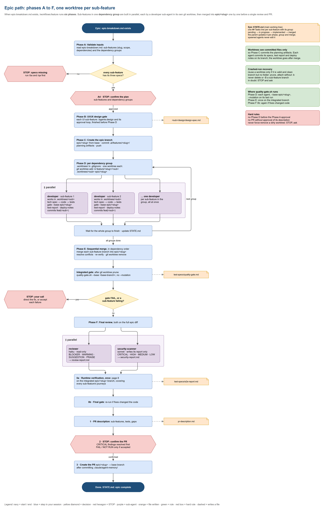
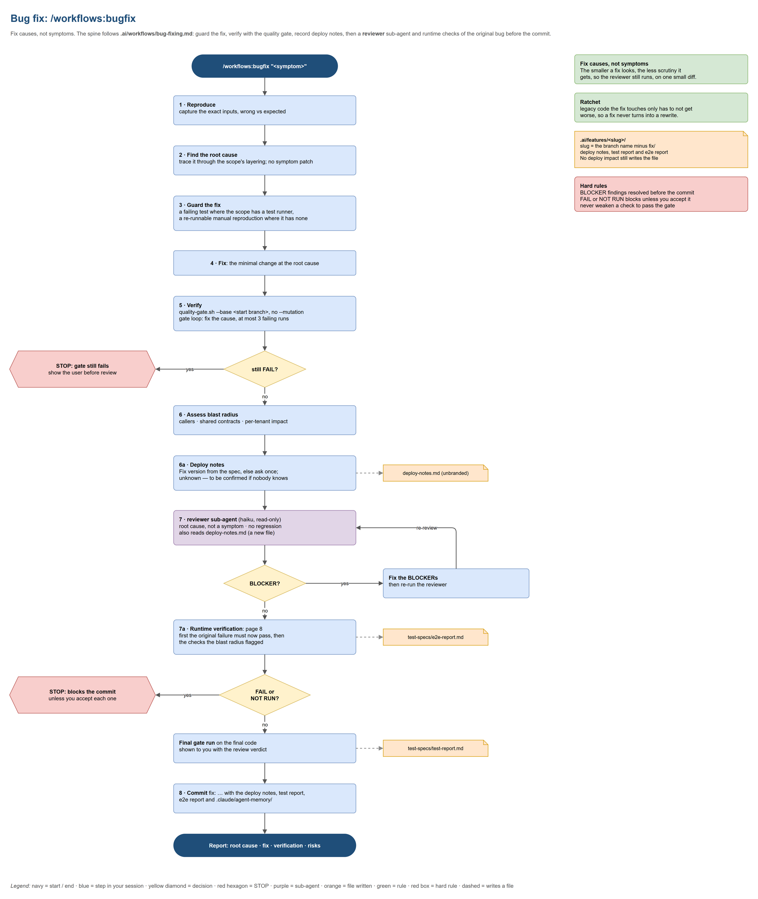
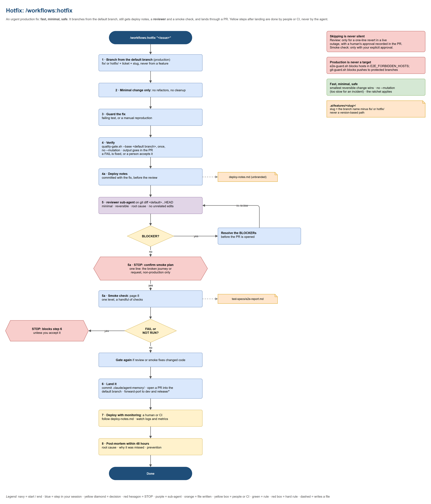
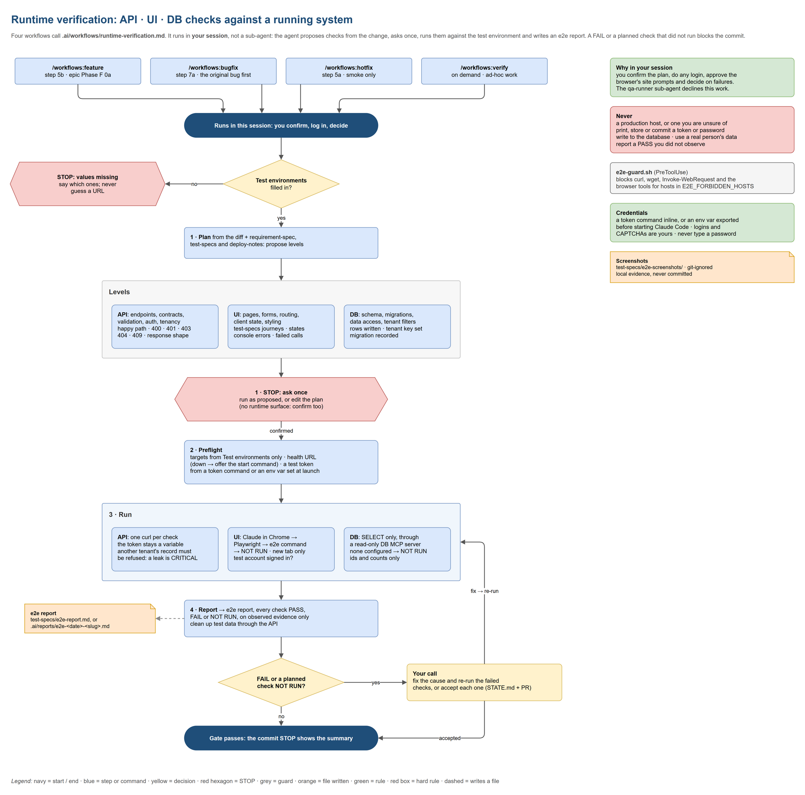

# AI Dev Harness — how the agent system works

The AI Dev Harness is a layer on top of Claude Code that takes work from a requirement to a pull
request. It has specialist agents (a persona per role, plus sub-agents that run in a fresh context),
shared project knowledge in Markdown, workflows with human approval gates, and guardrails: hooks that
block or warn on risky actions, and a quality gate that measures each change. This guide explains how
the pieces fit together, with a diagram for each part.

- **Audience:** developers, business analysts, testers, tech leads and release owners who use the
  harness in a project, and whoever maintains the harness itself.
- **Where it lives:** the knowledge layer in [`.ai/`](../../.ai/README.md), the execution layer in
  [`.claude/`](../../.claude/README.md), and the full command list in [`COMMANDS.md`](../../COMMANDS.md).
  For one entry per component, see [`../components.md`](../components.md).
- **Diagrams:** the editable source is one multi-page draw.io file,
  [`diagrams/ai-dev-harness/ai-dev-harness.drawio`](diagrams/ai-dev-harness/ai-dev-harness.drawio).
  The PNGs are exported from it (see [Updating the diagrams](#updating-the-diagrams)).

## Contents

1. [Architecture — knowledge layer vs execution layer](#1-architecture--knowledge-layer-vs-execution-layer)
2. [Agent pattern — command, persona, sub-agent](#2-agent-pattern--command-persona-sub-agent)
3. [End-to-end delivery lifecycle](#3-end-to-end-delivery-lifecycle)
4. [Feature workflow — `/workflows:feature`](#4-feature-workflow--workflowsfeature)
5. [Epic path — Phases A–F](#5-epic-path--phases-af)
6. [Bug fix — `/workflows:bugfix`](#6-bug-fix--workflowsbugfix)
7. [Hotfix — `/workflows:hotfix`](#7-hotfix--workflowshotfix)
8. [Runtime verification — `/workflows:verify`](#8-runtime-verification--workflowsverify)
9. [Quality gate — `quality-gate.sh`](#9-quality-gate--quality-gatesh)
10. [Release — `/workflows:release`](#10-release--workflowsrelease)
11. [Hooks and guardrails](#11-hooks-and-guardrails)
12. [Self-improvement — `/harness:improve`](#12-self-improvement--harnessimprove)
13. [Cross-cutting concepts](#13-cross-cutting-concepts)
14. [Which command do I use?](#14-which-command-do-i-use)
15. [Updating the diagrams](#updating-the-diagrams)

---

## 1. Architecture — knowledge layer vs execution layer


You type a slash command in a Claude Code session. The session runs files from `.claude/`, which
pull in the Markdown in `.ai/` through `@`-includes. The same command therefore behaves correctly in
every project once `.ai/` is filled in by `/init-project`.

| Layer | Folder | Holds | Executes? |
|---|---|---|---|
| Knowledge | `.ai/` | Personas, workflow playbooks, standards, templates, project config and context, memory, and the artifacts each feature produces | No. Markdown only; it is read, never run |
| Execution | `.claude/` | Slash commands, sub-agents, hooks and `hooks.env`, `settings.json`, helper scripts, path-scoped rules, `HARNESS_VERSION` | Yes. Claude Code runs it |
| Root files | `CLAUDE.md`, `AGENTS.md`, `COMMANDS.md`, `.mcp.json` | Per-session guidance, the method for non-Claude agents, the command list, the MCP servers | `CLAUDE.md` is loaded into every session |

**Knowledge layer (`.ai/`)**

| Path | Purpose |
|---|---|
| [`.ai/agents/`](../../.ai/agents) | 16 personas: each role's responsibilities, method, output format and never-do list |
| [`.ai/workflows/`](../../.ai/workflows) | 8 playbooks: the method each command follows |
| [`.ai/standards/universal/`](../../.ai/standards/universal) | Portable principles: coding, API design, security baseline, testing, accessibility, UI/UX, frontend design, git workflow |
| [`.ai/standards/project/`](../../.ai/standards/project) | Your stack's rules (`tech-specific.md`) and the design system under `frontend/design/`; the per-stack folders are reference only |
| [`.ai/templates/`](../../.ai/templates) | 14 output templates, from `technical-spec.md` to `feature-state.md` |
| [`.ai/config/`](../../.ai/config) | `project-config.md` (stack, commands, test environments, release deliverables), `branding.md`, `current-scope.md`, plus per-scope copies |
| [`.ai/context/`](../../.ai/context) | `project-overview.md`, `architecture.md`, `business-rules.md`, plus per-scope copies |
| [`.ai/memory/`](../../.ai/memory) | `decisions.md`, `learnings.md`, `design-taste.md`: append-only, committed |
| [`.ai/features/`](../../.ai/features) | One folder per feature slug with its specs, reports, `STATE.md` and `deploy-notes.md` |
| [`.ai/CUSTOMIZATION.md`](../../.ai/CUSTOMIZATION.md) | The 13 variability axes and the files and tokens each one owns |
| `.ai/reports/`, `.ai/releases/<version>/` | Created on first use: standalone reports, `quality-baseline.md`, and each release's internal artifacts |

**Execution layer (`.claude/`)**

| Path | Purpose |
|---|---|
| [`.claude/commands/`](../../.claude/commands) | 27 slash commands: the studios (`/init-project`, `/ba`, `/qa`) and the `agents:`, `workflows:`, `utils:` and `harness:` families |
| [`.claude/agents/`](../../.claude/agents) | 8 sub-agents, each with its own context window, tool list and model |
| [`.claude/hooks/`](../../.claude/hooks) | 9 hook scripts and [`hooks.env`](../../.claude/hooks/hooks.env), the one config they all read |
| [`.claude/settings.json`](../../.claude/settings.json) | Registers each hook on its event and tool matcher |
| [`.claude/scripts/`](../../.claude/scripts) | `quality-gate.sh` and its engine `quality-metrics.py`, `devops-mode.sh`, `md-to-docx.py` |
| [`.claude/rules/`](../../.claude/rules) | Path-scoped rules that load only when Claude reads or edits a matching file |
| [`.claude/HARNESS_VERSION`](../../.claude/HARNESS_VERSION) | The template release a project was set up from |
| `.claude/agent-memory/<agent>/` | Created on first run by the four sub-agents with `memory: project`; committed with the workflows' changes |

The `examples/` folder holds both layers filled in for a fictional project. It is a reference for
what a configured file looks like and is not part of the running harness.

**Optional integrations.** [`.mcp.json`](../../.mcp.json) ships three MCP servers: `atlassian`
(remote, OAuth, no secret in the file), `figma-bridge` and `playwright` (both started with `npx`). You
authenticate once with `/mcp`. Tools are granted per command: `/ba` can take a Jira issue key as its
input, `/agents:pm` and `/utils:standup` (both load `pm-agent.md`) can enrich status from
Jira, and `/workflows:release` can transition released Jira issues behind a STOP. For UI checks, Claude in Chrome is the default driver (start Claude
Code with `--chrome`), Playwright MCP is the fallback, then the project's e2e command. A read-only
database MCP server is optional and added by `/init-project`. Every step that uses an integration is
conditional: with no server connected, the harness falls back to the manual path, and a check that
cannot run is reported as NOT RUN.

---

## 2. Agent pattern — command, persona, sub-agent


An agent is defined and reached in up to four ways:

1. **Persona** — `.ai/agents/<name>-agent.md` holds the behaviour: responsibilities, method, output
   format and what never to do. You cannot run a persona on its own.
2. **Command** — a file under `.claude/commands/` `@`-includes the persona plus the standards,
   templates or playbook it needs. It adds scope detection, the `allowed-tools` line and the task.
   You run it as `/name <arguments>`.
3. **Sub-agent** — `.claude/agents/<name>.md` loads the same persona with an `@`-include in its body,
   and sets its own `tools`, `model`, `effort`, `maxTurns` and `memory`. Workflow commands spawn it as
   a Task agent with a fresh context. You never type a sub-agent's name.
4. **Orchestrator** — the `orchestrator` sub-agent may delegate to `developer`, `reviewer`,
   `security-scanner` and `qa-runner` (its `tools` line). No command spawns it.

**Defer to the persona.** Behaviour is written once. `/agents:review` and the `reviewer` sub-agent
both load `reviewer-agent.md`, which owns the review method and the BLOCKER / WARNING / SUGGESTION /
PRAISE vocabulary. The sub-agent file adds only scope loading, its memory folder and the output it
returns. To change how reviews work, you edit the persona once and both paths follow. This is
invariant 2 in [`harness-improvement.md`](../../.ai/workflows/harness-improvement.md).

Some commands load a playbook instead of a persona: `/workflows:hotfix` loads
`hotfix-process.md`, `/workflows:release` loads `release-process.md`, `/workflows:verify` loads
`runtime-verification.md`, and the utilities mostly load nothing.

**Notable sub-agent settings**

- `reviewer` — `model: haiku`, `permissionMode: plan`, tools `Read, Bash` only. It saves its report
  through Bash; it has no Write or Edit tool for the project.
- `critic` — `model: inherit`, `effort: high`, tools `Read, Bash`: read-only, used to break authored
  harness changes.
- `security-scanner` — `model: sonnet`, `effort: high`, tools `Read, Bash, Write`; it writes only the
  report it is asked for.
- `release-manager` — `model: sonnet`, `maxTurns: 30`.
- `qa-runner` — Playwright MCP browser tools in its `tools` line. It declines runtime verification,
  which runs in your session.
- `memory: project` on `reviewer`, `security-scanner`, `critic` and `harness-engineer`: each keeps
  `.claude/agent-memory/<agent>/MEMORY.md`, reads it before the work and ends with a `Memory:` line.
- Read-only commands: `/agents:review`, `/agents:security`, `/harness:ask`, `/utils:status` and
  `/utils:docs-serve` set `disallowed-tools: Write, Edit, MultiEdit, NotebookEdit`.

---

## 3. End-to-end delivery lifecycle


The standard path for a ticket:

```text
Jira issue (key + Fix version)      → read through the Atlassian MCP server when it is connected
/ba <slug>                    → requirement-spec.md (with Fix version), user-stories.md, epic-breakdown.md for an epic
/qa <slug>                    → test-specs.md (one per sub-feature for an epic)
/workflows:feature <slug>     → STATE.md, technical-specs/, design/design-spec.md, test-specs/test-report.md
                                (with ## Quality gate), test-specs/quality-gate.md for an epic, review-report.md,
                                security-report.md, deploy-notes.md, test-specs/e2e-report.md, pr-description.md
  … pull request: you open it from pr-description.md (the epic path opens it after a STOP);
    a person reviews and merges …
/workflows:release <version>  → .ai/releases/<version>/ (release notes, migration plan, rollback plan,
                                deployment checklist, security report), CHANGELOG.md, git tag,
                                docs/release/<version>/ deployment guide if switched on
  … deploy: people or CI; the agent never deploys and is blocked from production hosts …
```

Key points:

- **People decide at every stage.** `/ba` and `/qa` are interviews. `/workflows:feature` stops at
  the spec, the design (UI only) and the commit; `/workflows:release` stops on a CRITICAL finding,
  before it finalizes, and before any Jira update. Reviewing and merging the pull request, and
  the deploy, are done by people.
- **The quality gate runs inside the change workflows** (section 9): feature, epic, bug fix and
  hotfix. Its final run is kept in `test-specs/test-report.md` (`test-specs/quality-gate.md` for an
  epic, the PR for a hotfix). The release does not run it; it runs each changed sub-project's lint,
  test and build commands.
- **Studios produce, workflows consume.** `/workflows:feature` never writes stories, epic
  breakdowns or test specs. If they are missing it stops and tells you to run `/ba` and `/qa`.
- **One folder per feature.** Everything lands under `.ai/features/<slug>/`, which is the hand-off
  surface between BA, QA and development.
- **Fix version flows through.** `/ba` records it in the spec's `## Source issue` block (from
  Jira, from you, or `unknown — to be confirmed`). Each change copies it into `deploy-notes.md`.
- **Deploy notes feed the release.** Feature, bugfix and hotfix each write `deploy-notes.md`, even
  when there is no deploy impact. `/workflows:release` selects them by fix version.
- **Branding.** Every document except `STATE.md` and `deploy-notes.md` opens with the header from
  `.ai/templates/artifact-header.md`.

Other ways in: `/agents:dev "<change>"` for a quick change without studio specs (it runs the
quality gate where it is configured; check it with `/workflows:verify`), any single specialist under
`/agents:*`, `/workflows:bugfix` (it commits; you open the PR) and `/workflows:hotfix` (it opens the
PR into the default branch) for fixes, and `/harness:ask` or `/harness:improve` for the harness
itself. The `/utils:*` commands work at any time.

---

## 4. Feature workflow — `/workflows:feature`


The command is [`.claude/commands/workflows/feature.md`](../../.claude/commands/workflows/feature.md);
the playbook is [`.ai/workflows/feature-development.md`](../../.ai/workflows/feature-development.md).

Things to know when you run it:

- **It decides single vs epic from what `/ba` wrote.** `epic-breakdown.md` present means the epic
  path (section 5). It does not re-analyse your request.
- **STOP gates:** missing BA/QA inputs; step 2, approve the technical spec (and answer one question:
  per-task atomic commits, default off); step 2a, approve the design Artifact, with the Architect's
  approval as well (UI features only); step 4, a quality gate that still fails; step 6, confirm the
  commit.
- **Who does what.** The developer sub-agent implements from the `## Tasks` checklist in `STATE.md`
  and writes the tests and the test report. The reviewer and security-scanner sub-agents run in
  parallel on the same diff. Every gate stays in your session.
- **How the quality gate runs** (section 9). The developer agent runs `.claude/scripts/quality-gate.sh --base
  <base-branch>` in a loop: fix the cause, at most 3 failing runs, `--mutation` on its last run only.
  Your session then re-runs it without `--mutation`, and that run replaces `## Quality gate` in
  `test-specs/test-report.md`. At step 6 it runs again if review or runtime fixes changed the code.
  `NOT CONFIGURED` falls back to manual verification; `PASS (partial: …)` means the named build or
  tests were run by hand.
- **Step 5a** writes `deploy-notes.md` before the commit STOP, so the file rides the same commit.
- **Step 5b** runs runtime verification in your session (section 8) and writes
  `test-specs/e2e-report.md`.
- **What blocks the commit.** Unresolved CRITICAL security findings, and any runtime FAIL or NOT RUN
  that you have not accepted in your own words (recorded in `STATE.md`).
- **Resume.** `STATE.md` is updated after every step, at every STOP and before every Task spawn. On
  a re-run, the workflow checks that each phase marked done has its file on disk, re-runs any that
  do not, and continues from `## Next action`.

---

## 5. Epic path — Phases A–F



| Phase | What happens |
|---|---|
| A — Validate inputs | Reads `epic-breakdown.md`; checks every sub-feature has `requirement-spec.md`, `user-stories.md` and `test-specs.md` (missing → STOP); **STOP** to confirm the sub-features and dependency groups |
| B — UI/UX design gate | `/agents:design` and its approval loop for each UI sub-feature, before any autonomous work |
| C — Epic branch | Creates `epic/<slug>`, commits the planning artifacts under `.ai/features/<slug>/`, pushes |
| D — Parallel implementation | Per dependency group: one git worktree per sub-feature under `.worktrees/`, one developer sub-agent each, all at once; the next group waits for this one |
| E — Sequential merge | Merges each sub-feature branch into `epic/<slug>` in dependency order, re-verifies, removes the worktree; then runs the quality gate once on the integrated branch → `test-specs/quality-gate.md` |
| F — Final review and PR | Reviewer and security scanner in parallel on the full epic diff; runtime verification once; final gate if code changed; `pr-description.md`; **STOP** to confirm the PR |

- Worktrees only see committed files, so Phase C must commit the planning artifacts first. Add
  `.worktrees/` to the project's `.gitignore`.
- Each developer agent writes its technical spec, test report and deploy notes inside its worktree
  and commits them on `feature/<slug>/<sub>`, with `quality-gate.sh --base epic/<slug>`.
- The epic `STATE.md` lives in the main working tree. Only the parent session edits it; it tracks
  each sub-feature as pending, in progress, implemented or merged.
- After a crash, the workflow reuses a worktree only if it is valid and clean. It never deletes or
  force-recreates a sub-feature branch, and never force-removes a dirty worktree; in doubt it stops
  and asks you.
- A gate still failing in Phase E stops for your direction or explicit acceptance.

---

## 6. Bug fix — `/workflows:bugfix`



Things to know when you run it:

- **Guard the fix first:** a failing test where the scope has a test runner, a re-runnable manual
  reproduction where it has none.
- **Quality gate:** `quality-gate.sh --base <branch the fix started from>`, no `--mutation`, at most
  3 failing runs. Still failing → STOP before the review. Its ratchet means legacy code you touch
  only has to not get worse.
- **Deploy notes (step 6a)** go to `.ai/features/<slug>/deploy-notes.md`, where the slug is the
  branch name minus `fix/`. The fix version comes from the spec; if there is none the workflow asks
  you once, and writes `unknown — to be confirmed` if nobody knows.
- **Review gate (step 7):** a `reviewer` sub-agent checks the fix addresses the root cause and also
  reads the new deploy notes. BLOCKER findings must be fixed and re-reviewed before the commit.
- **Runtime verification (step 7a)** first proves the original failure now behaves, then checks
  what the blast-radius step flagged. A FAIL or NOT RUN blocks the commit unless you accept it.
- **Before the commit** the gate runs once more on the final code, and that run is saved under
  `## Quality gate` in `test-specs/test-report.md` and shown with the review verdict. The commit uses
  a `fix:` prefix and includes the deploy notes, test report, e2e report and any
  `.claude/agent-memory/` changes.

---

## 7. Hotfix — `/workflows:hotfix`



Things to know when you run it:

- **Branch from the default branch** (production), never from a feature branch, as `fix/` or
  `hotfix/` plus ticket and slug.
- **One gate run:** `quality-gate.sh --base <default branch>` once, no `--mutation`. Its output goes
  in the PR. A FAIL is fixed or explicitly accepted by a person in the PR; if review or smoke fixes
  change the code, the gate runs again.
- **Deploy notes (step 4a)** are committed with the fix before the review, so the reviewer sees them.
- **Review gate (step 5):** a `reviewer` sub-agent on `git diff <default>...HEAD`. BLOCKERs must be
  resolved before the PR. It may be skipped only for a one-line revert during a live outage, with a
  person's approval recorded in the PR, never silently.
- **Smoke check (step 5a):** one broken journey or request against a non-production environment.
  The agent proposes it in one line and waits for your yes. Skipping it also needs your explicit
  approval, recorded in the PR.
- **Land it (step 6):** a PR into the default branch, then forward-port to the development and
  `release/*` branches. The deploy and the post-mortem (within 48 hours) are done by people or CI; the
  agent is blocked from production hosts.

---

## 8. Runtime verification — `/workflows:verify`



The playbook is [`.ai/workflows/runtime-verification.md`](../../.ai/workflows/runtime-verification.md).
`/workflows:feature` (step 5b, or epic Phase F step 0a), `/workflows:bugfix` (step 7a) and
`/workflows:hotfix` (step 5a, smoke only) call it; `/workflows:verify` runs it on demand for ad-hoc
work or a `/agents:dev` change, and never commits.

Things to know when you run it:

- **It runs in your session, not a sub-agent**, so you confirm the plan, do any login, approve the
  browser's site prompts and decide on failures.
- **Test environments** in `.ai/config/project-config.md` must be filled in. If not, it stops and
  says which values are missing; it never guesses a URL.
- **Plan, then one STOP.** It proposes API, UI and DB checks from the diff and the feature's specs,
  shows what it will not check, and asks you once to run or edit the plan.
- **Drivers:** UI checks use Claude in Chrome, then Playwright MCP, then the project's e2e command,
  else NOT RUN. Claude in Chrome opens a new tab and first checks a test account is signed in. DB
  checks are `SELECT` only through a read-only database MCP server, or NOT RUN.
- **Credentials:** a token command substituted inline in each request, or an environment variable
  exported before you start Claude Code. It never prints, stores or commits a token, and never types a
  password.
- **Report:** `test-specs/e2e-report.md` for a feature, or `.ai/reports/e2e-<date>-<slug>.md`. Every
  planned check is PASS, FAIL or NOT RUN, on observed evidence only. Screenshots stay local and
  git-ignored.
- **Gate:** a FAIL or a planned check that did not run blocks the commit unless you accept it, in
  your words, recorded in `STATE.md` and the PR.

---

## 9. Quality gate — `quality-gate.sh`


The script is [`.claude/scripts/quality-gate.sh`](../../.claude/scripts/quality-gate.sh); its
coverage, complexity and CRAP engine is `quality-metrics.py`. It gives one PASS or FAIL for the
change, with the numbers, and judges only what the change touched. Legacy code a change touches only
has to not get worse, so a bug fix never turns into a rewrite.

```bash
.claude/scripts/quality-gate.sh --base <ref> [--mutation]   # measure the change since <ref>
.claude/scripts/quality-gate.sh --baseline                  # snapshot the whole codebase
```

| Check | Set in `hooks.env` | Fails when |
|---|---|---|
| gate-config | Always on | A check would run blind. Otherwise it warns on each `hooks.env`, `.gitattributes` and gate-file change, since loosening the gate needs your words |
| build | `GATE_BUILD_CMD` | The command exits non-zero |
| typecheck, lint | `TYPECHECK_CMD`, `LINT_CMD`, in each touched `PACKAGE_DIRS` dir (a `PACKAGE_CMDS` entry overrides them there) | A command exits non-zero |
| test | `GATE_TEST_CMD`, which should write `COVERAGE_REPORTS` | A test fails, or no coverage report came from this run |
| metrics | `COVERAGE_MIN`, `COMPLEXITY_MAX`, `CRAP_MAX` (needs python 3 and `pip install lizard`) | Too few changed lines ran under test, or a new or more complex function is over the complexity or CRAP limit |
| suppressions | `SUPPRESSION_CHECK` (`block` or `warn`) | In `block` mode, the change silences a check or skips a test; `warn` lists each one for the reviewer |
| test-removal | `SUPPRESSION_CHECK`, `TEST_ASSERTION_PATTERNS` | In `block` mode, the change removes or rewrites a test case or assertion |
| mutation | `MUTATION_CMD`, `MUTATION_GLOBS`; only with `--mutation`, once everything else passed | The tool's threshold is missed; the result is kept for that exact change |

Each check is skipped while its `hooks.env` value is blank.

Things to know:

- **Verdicts.** `PASS` and `PASS (partial: …)` exit 0; partial names a build or test step that is
  not configured, so you run it by hand. `NOT CONFIGURED` means no gate values are set, and the
  workflow falls back to its own verification. `FAIL` exits 1 and the workflow stops. A configured
  check that cannot run counts as a FAIL.
- **A change cannot loosen it for itself.** `hooks.env` is parsed as data, never run, and the base
  commit's stricter limits, suppression mode and file lists are kept. After set-up, loosening a limit
  needs your explicit approval and a line in `.ai/memory/decisions.md`; removing a check is refused.
- **Change id.** The first output line is a hash of the changed source and test files, so you can
  tell which code a recorded result measured. Full logs go under `.git/quality-gate/`.
- **`--baseline`** measures the whole codebase and writes `.ai/reports/quality-baseline.md`. It
  judges nothing; `/init-project` uses it to choose the limits, and re-running it shows the trend.
- **At the commit STOP** you see the gate's table of touched functions with their complexity,
  coverage and CRAP, so you can review structure and names instead of reading every line.

Where it runs:

| Where | How |
|---|---|
| `/init-project` | `--base HEAD~1` once, to prove the commands and report paths, then `--baseline` |
| `/workflows:feature` | The developer sub-agent loops: fix the cause, at most 3 failing runs, one clean-up pass, `--mutation` on its last run. Your session re-runs it without `--mutation` and saves `## Quality gate` in `test-specs/test-report.md`; it runs again at the commit STOP if fixes changed the code |
| Epic path | Each sub-feature in its worktree with `--base epic/<slug>`; Phase E once on the merged branch → `test-specs/quality-gate.md`; Phase F again if the code changed |
| `/workflows:bugfix` | `--base <branch the fix started from>`, no `--mutation`, at most 3 failing runs; still failing → STOP before the review. The final run before the commit goes in `test-specs/test-report.md` |
| `/workflows:hotfix` | `--base <default branch>` once, no `--mutation`; its output goes in the PR. A FAIL is fixed, or a person accepts it in the PR |
| Ad hoc | `/agents:dev` and `/agents:qa` run it where it is configured; you can run `quality-gate.sh --base main` yourself |
| `/workflows:release` | Not used: each changed sub-project's lint, test and build commands run instead |

---

## 10. Release — `/workflows:release`


Things to know when you run it:

- **Step 1 runs two sub-agents in parallel:** `security-scanner` on `git diff <last tag>..HEAD` with
  a dependency audit, and `release-manager`, which writes release notes, migration plan, rollback
  plan and deployment checklist to `.ai/releases/<version>/` from the deploy notes whose fix version
  matches.
- **CRITICAL findings stop the release.** HIGH findings are shown and you decide whether to go on.
- **Step 2** runs each changed sub-project's lint, test and build commands from its project-config.
  `quality-gate.sh` is not part of the release path.
- **Step 3 STOP:** you see the security verdict, artifact paths, the deploy notes in scope (and any
  with no deploy impact or an unknown fix version), the gate results, and what step 4 will do with the
  deployment guide.
- **Step 4** bumps each manifest (fix → patch, feat → minor, breaking → major) and updates
  `CHANGELOG.md`. If the deployment guide is switched on in `project-config.md` → Release deliverables,
  it creates or merges `docs/release/<version>/deployment-guide-<version>.md`, regenerates the Word
  copy with `.claude/scripts/md-to-docx.py` if that is on, and refreshes `docs/release/README.md`. An
  existing guide is merged, never overwritten.
- **Then** one commit (`chore(release): bump version to <version>`) and `git tag <version>`. If the
  Atlassian MCP server is connected, a last STOP shows the issues, transition and comment before
  anything is sent. The workflow never pushes or deploys.

---

## 11. Hooks and guardrails


Hooks are registered in [`.claude/settings.json`](../../.claude/settings.json) and need `bash` on
`PATH`. Every script sources [`.claude/hooks/hooks.env`](../../.claude/hooks/hooks.env) and skips any
check whose value is blank or `"off"`, so an unconfigured template blocks nothing. Exit code 2 blocks
the tool call and Claude reads the stderr; exit 0 allows it, and a warning reaches Claude only as
`additionalContext` JSON on stdout. The Stop reminder goes to you as a `systemMessage`.

| Hook | Behaviour |
|---|---|
| `pre-tool-use.sh` (PreToolUse: Edit, Write, MultiEdit) | **Blocks** edits to `MIGRATIONS_GLOB` files, and with `SUPPRESSION_CHECK=block` an edit that adds a suppression or skipped test. Warns on `.env` files, production config and `SENSITIVE_CONFIG_GLOBS`; notes edits to `hooks.env` |
| `git-guard.sh` (PreToolUse: Bash) | **Blocks** `git push --force` and `git reset --hard` with no override, pushes to `PROTECTED_BRANCHES`, and `DEPLOY_CMD` aimed at `PROD_STAGE`. Warns on a push from a branch outside `WORK_BRANCH_PREFIXES` |
| `e2e-guard.sh` (PreToolUse: Bash, PowerShell, Claude in Chrome, Playwright) | **Blocks** HTTP clients and browser tool calls that name a host in `E2E_FORBIDDEN_HOSTS` |
| `post-tool-use.sh` (PostToolUse: Edit, Write, MultiEdit) | Warns: type-check and lint of the edited package, tenant isolation, frontend env, design tokens, TDD nudge, suppressions in `warn` mode |
| `post-tool-batch.sh` (PostToolBatch) | Warns: full type-check of a package dir when two or more of its files changed in one batch |
| `post-tool-failure.sh` (PostToolUseFailure: Edit, Write, Bash) | Hint: classifies a failed call (type, lint, migration, missing module) and passes a fix hint to Claude as context |
| `stop-check.sh` (Stop) | Reminds you of uncommitted tracked changes on a work branch |
| `user-prompt-context.sh` (UserPromptSubmit) | Adds the current branch and scope before each prompt |
| `compact-restore.sh` (SessionStart, compact) | Re-injects branch, scope, the in-progress feature or epic, `STATE.md` phase and next action, and the last 5 commits |

To change a guardrail, edit `.claude/hooks/hooks.env`, not the scripts.

Safeguards beyond hooks:

- `quality-gate.sh` measures every change at the workflows' verify steps; a FAIL stops the workflow.
  It keeps the base commit's stricter limits, so a change cannot loosen them for itself.
- Least privilege in frontmatter: `reviewer` and `critic` have no Write or Edit tool, and five
  commands disallow writes.
- `/agents:devops` is advise-only by default. `.claude/scripts/devops-mode.sh on | off | status`
  rewrites its `allowed-tools` line; in execute mode each command still needs your approval.
- STOP gates in every workflow, and every outward write (Jira update, PR) is shown and confirmed
  first. MCP tools are granted per command, and `.mcp.json` holds no secrets.

---

## 12. Self-improvement — `/harness:improve`


The loop, from [`.ai/workflows/harness-improvement.md`](../../.ai/workflows/harness-improvement.md):

1. **Plan** — restate the goal and split it into work packages with disjoint file sets. **STOP**:
   you confirm the plan before any edit.
2. **Author** — one `harness-engineer` sub-agent per package, in parallel. Shell changes are run for
   real (`bash -n` and smoke runs in a throwaway git repo).
3. **Critique** — one read-only `critic` per package verifies every claim itself and grades findings
   CRITICAL, MAJOR or MINOR.
4. **Revise** — a `harness-engineer` fixes every CRITICAL and MAJOR finding, or rebuts it with
   evidence.
5. **Recheck** — a fresh `critic` confirms the fixes. At most two rounds, then **STOP** and you decide.
6. **Integrate** — one critic audits the whole change: file ownership, cross-file contracts, the
   mirror invariant, `bash -n`, broken references, and the doc inventories with their counts.
7. **Verify and land** — run the verification block, show the diff summary, then **STOP**. It commits
   only on your approval, on a `feature/` branch. A template release also bumps `HARNESS_VERSION`
   and the `docs/index.html` sidebar version and is tagged `v<version>`. Lessons go to
   `.ai/memory/learnings.md`.

The playbook has 13 numbered rules: 8 invariants (two-layer split, three-layer agent pattern,
template genericness, inert-safety, gate integrity, mirror invariant, docs inventories, tool least
privilege) and 5 integration rules (no secrets in config, per-command grants, outward writes behind
gates, optional by default, agents never authenticate). Breaking any of them is a CRITICAL defect.

For questions rather than changes, `/harness:ask <question>` is read-only. It uses
`harness-guide-agent.md`, answers from the repo's own files, cites the paths, and redirects product
code questions to the right command.

---

## 13. Cross-cutting concepts

- **Scope.** Most commands and sub-agents first read `.ai/config/current-scope.md`. A
  `# Forced scope:` line wins; otherwise they infer backend, frontend or fullstack from the request
  and load only that scope's config, context and standards. Force a scope with `/utils:scope`.
- **Branding.** `.ai/config/branding.md` and `.ai/templates/artifact-header.md` put your header on
  every generated document, except `STATE.md` and `deploy-notes.md`.
- **Workflow state.** `STATE.md`, from `.ai/templates/feature-state.md`, is what makes the feature
  and epic workflows resumable; `compact-restore.sh` prints its next action after compaction.
- **Memory.** `.ai/memory/decisions.md`, `learnings.md` (add with `/utils:learn`) and
  `design-taste.md`, plus `.claude/agent-memory/<agent>/` for the sub-agents with `memory: project`.
  All are committed.
- **Path-scoped rules.** A `.md` file under `.claude/rules/` with `paths:` frontmatter loads only when
  Claude touches a matching file; `_example-area.md` is an inert example.
- **Model and effort.** Set per sub-agent in the frontmatter of `.claude/agents/*.md`, and per
  command in `.claude/commands/**`.
- **Template tokens.** `{{TOKENS}}` and `> [FILL IN: …]` blocks are filled by `/init-project`, which
  also records `HARNESS_VERSION`.
- **Other agents.** [`AGENTS.md`](../../AGENTS.md) carries the same method for non-Claude agents; see
  [`../portability.md`](../portability.md).

---

## 14. Which command do I use?

| I want to… | Run |
|---|---|
| Set the harness up in a new repo | `/init-project` |
| Turn a need into a requirement and stories | `/ba <slug>` |
| Write the test spec for a feature | `/qa <slug>` |
| Build a feature or epic end to end | `/workflows:feature <slug>` |
| Fix a bug | `/workflows:bugfix "<symptom>"` |
| Fix production urgently | `/workflows:hotfix "<issue>"` |
| Check a change against a running system | `/workflows:verify [<slug> \| what changed]` |
| Prepare a release | `/workflows:release <version>` |
| Write stories without the interview | `/agents:ba` |
| Design a solution or write an ADR | `/agents:architect` |
| Design a UI with an Artifact preview | `/agents:design` |
| Make a quick change without studio specs | `/agents:dev "<change>"` |
| Write or run tests | `/agents:qa` |
| Review recent changes | `/agents:review` |
| Run a security audit | `/agents:security` |
| Work on CI/CD or infrastructure | `/agents:devops` |
| Get a status report or plan | `/agents:pm` |
| Prepare a release package on its own | `/agents:release-manager` |
| Check project health | `/utils:status` |
| Get a standup summary | `/utils:standup` |
| Generate a changelog from commits | `/utils:changelog` |
| Generate or update docs | `/utils:docs` |
| Browse `.ai/` as a local site | `/utils:docs-serve` |
| Force backend, frontend or fullstack | `/utils:scope <backend\|frontend\|fullstack\|auto>` |
| Record a lesson | `/utils:learn "<lesson>"` |
| Ask how the harness works | `/harness:ask "<question>"` |
| Change the harness itself | `/harness:improve "<change>"` |

Full arguments and outputs: [`COMMANDS.md`](../../COMMANDS.md).

---

## Updating the diagrams

Edit `diagrams/ai-dev-harness/ai-dev-harness.drawio` in the draw.io desktop app or in VS Code with
the "Draw.io Integration" extension. It is one uncompressed file with one page per diagram. Then
export each page to its PNG from `docs/harness-docs/diagrams/ai-dev-harness/`:

```bash
# Windows default install; a per-user install is at %LOCALAPPDATA%\Programs\draw.io\draw.io.exe
# ("$LOCALAPPDATA/Programs/draw.io/draw.io.exe" in Git Bash).
# macOS: /Applications/draw.io.app/Contents/MacOS/draw.io · Linux: drawio (under xvfb-run if headless)
DRAWIO="/c/Program Files/draw.io/draw.io.exe"
names=(01-architecture 02-agent-pattern 03-delivery-lifecycle 04-feature-workflow 05-epic-path
       06-bug-fix 07-hotfix 08-runtime-verification 09-quality-gate 10-release 11-guardrails
       12-self-improvement)
for i in "${!names[@]}"; do
  "$DRAWIO" -x -f png -p $((i + 1)) -s 1.5 -b 20 -o "${names[$i]}.png" ai-dev-harness.drawio
done
```

Update the diagrams and this guide whenever a harness change adds, renames or removes a command,
agent, hook or workflow step.

This guide is also published as [`docs/how-it-works.html`](../how-it-works.html), linked from the
setup guide. That page is generated: after editing this file, run
`python docs/harness-docs/build-html.py` (`--check` reports whether the page is out of date) and
commit both files together.
