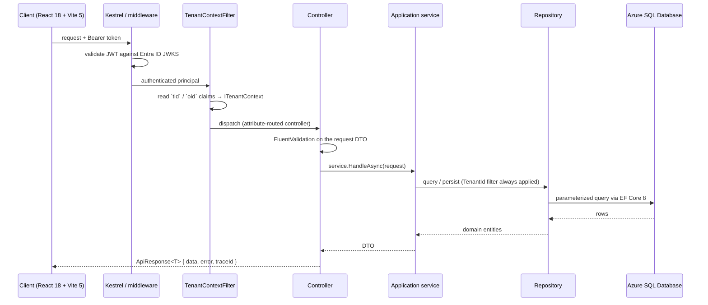
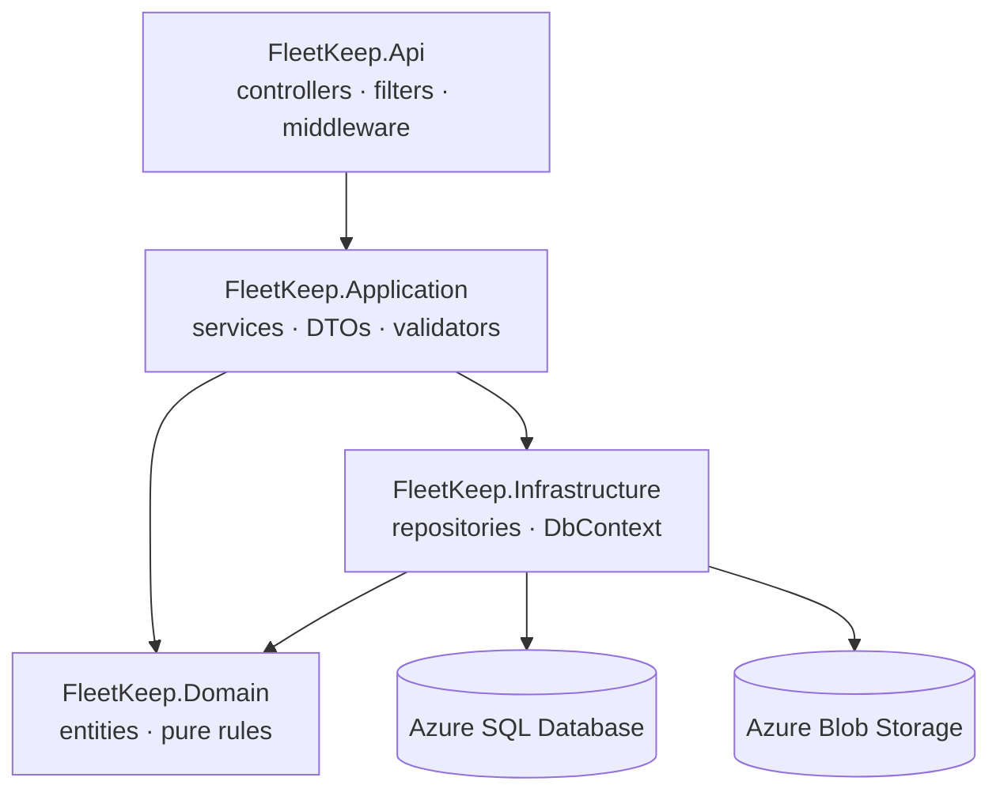

# Backend Architecture

## Request Flow



## Layer Diagram



Allowed dependencies point downward only. `FleetKeep.Domain` depends on nothing. `FleetKeep.Api`
never references `FleetKeep.Infrastructure` types directly — it resolves interfaces declared in
`FleetKeep.Application`.

## Routing Pattern

Attribute-routed controllers, one per aggregate root, all under `api/v1/`. Every route for a domain
is declared on its controller — there is no central route table and no minimal-API endpoints.

```csharp
[ApiController]
[Route("api/v1/[controller]")]
[Authorize]
public sealed class DefectsController(IDefectService defects) : ControllerBase
{
    [HttpPost]
    [Authorize(Policy = Policies.CanReportDefect)]
    public async Task<ActionResult<ApiResponse<DefectDto>>> Report(
        ReportDefectRequest request, CancellationToken ct)
        => Ok(ApiResponse.Ok(await defects.ReportAsync(request, ct)));
}
```

Versioning is in the path. A breaking change means `api/v2/...`, never a silent change to `v1`.

## Handler Structure

A controller action extracts nothing from the token itself (the filter already did that), runs
model binding plus FluentValidation, calls exactly one application service, and wraps the result.
It must **not** query the database, open a transaction, or contain a branch that encodes a business
rule. If an action grows a second service call plus conditional logic, that logic belongs in a
service.

## Service Layer

Application services live in `src/Api/FleetKeep.Application/<Aggregate>/` and are named
`<Aggregate>Service` (`DefectService`, `JobCardService`, `InspectionScheduleService`). One service
owns one aggregate's use cases, owns the transaction boundary, and calls repositories — never
`FleetKeepDbContext` directly. Cross-aggregate work is composed at the service layer (for example
`JobCardService` closing a card resolves defects and decrements parts stock in one transaction).

```
FleetKeep.Application/
├── Defects/      DefectService.cs · ReportDefectRequest.cs · ReportDefectValidator.cs · DefectDto.cs
├── JobCards/     JobCardService.cs · CloseJobCardRequest.cs · ...
├── Inspections/  InspectionScheduleService.cs · ...
└── Common/       ApiResponse.cs · IDateTimeProvider.cs · paging helpers
```

## Data Access Layer

`src/Api/FleetKeep.Infrastructure/` holds `FleetKeepDbContext`, one `IEntityTypeConfiguration` per
entity, the repositories, and `Migrations/`. Repositories are registered **scoped**, as is the
`DbContext`; nothing is a singleton that holds state across requests.

```
FleetKeep.Infrastructure/
├── FleetKeepDbContext.cs        # entities + the TenantId global query filter
├── Configurations/              # one IEntityTypeConfiguration per entity
├── Repositories/                # one per aggregate root, returning entities or projections
├── Migrations/                  # EF Core generated — never hand-edited
├── Blobs/ · Email/              # Azure SDK clients, managed-identity auth
└── Admin/                       # the ONLY place IgnoreQueryFilters() is permitted
```

Rules: always let the `TenantId` filter apply; never leak `IQueryable` across a layer boundary;
never write raw SQL outside a migration (and never with string interpolation); create migrations
with `dotnet ef migrations add`, never by hand; every migration must be backward-compatible with
the previously deployed API for one release, because deploys are rolling.

## Auth & Claims Extraction

1. `AddAuthentication().AddJwtBearer(...)` validates issuer, audience and signature against the
   Entra ID JWKS (cached by the handler).
2. `TenantContextFilter` — registered globally, runs before every action — reads `tid` (tenant) and
   `oid` (user object id) into the scoped `ITenantContext`. An unresolvable tenant returns 401.
3. FleetKeep roles are **not** taken from the token. They are loaded per request from the database
   for that tenant+user, so a role revocation takes effect immediately rather than at token expiry.
4. Policy-based authorization (`Policies.CanAuthoriseReturnToService`, `Policies.CanReportDefect`,
   …) gates privileged actions; a bare `[Authorize]` means "any authenticated member of a tenant".
5. Tenant identity is **never** read from the request body, route or query string — only from the
   token.

## Async Patterns

`src/Worker/FleetKeep.Worker` hosts two timer triggers:

- `InspectionDueScan` — 02:00 UTC daily. Iterates tenants, builds a tenant context per tenant,
  recomputes banding and raises due/overdue notifications. Idempotent: a re-run on the same day
  produces no duplicate notifications.
- `DefectEscalation` — hourly. Escalates category-A defects older than 4 hours and category-B
  older than 36 hours that are still unactioned.

There is no queue and no orchestration framework, and the worker reports no status back to callers
— its output is notifications plus audit rows. A tenant that throws is logged and skipped; the next
run retries it.

## Local Development & Configuration

- `dotnet watch run --project src/Api/FleetKeep.Api` → `https://localhost:7241`, Swagger UI at `/swagger`.
- SQL runs in Docker locally (`docker compose up sql`); `dotnet ef database update` applies migrations.
- Secrets in development come from `dotnet user-secrets` — never `appsettings.json`.
- In Azure, configuration arrives as App Settings, with secrets as Key Vault references resolved by
  the app's managed identity, and binds to typed options classes validated at startup
  (`ValidateOnStart`), so a missing setting fails the deploy rather than the first request.
- The worker reads the same configuration keys; adding a setting means adding it to both apps'
  Bicep modules.
