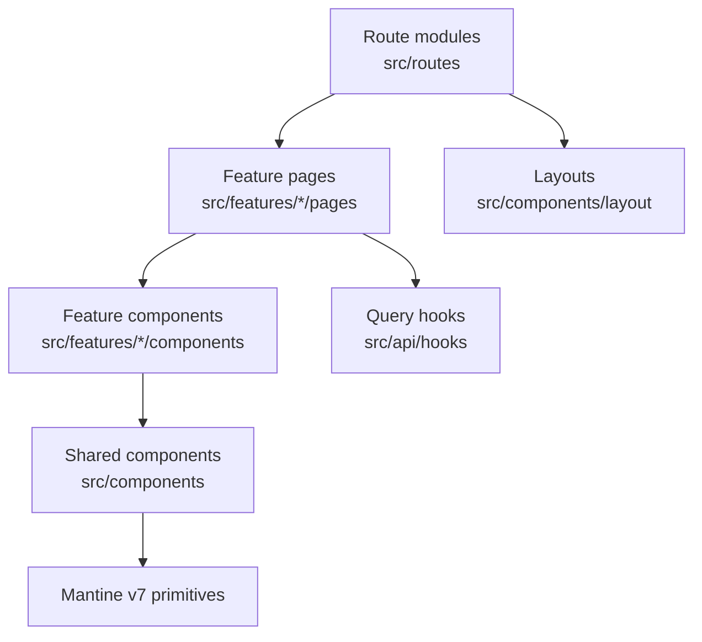
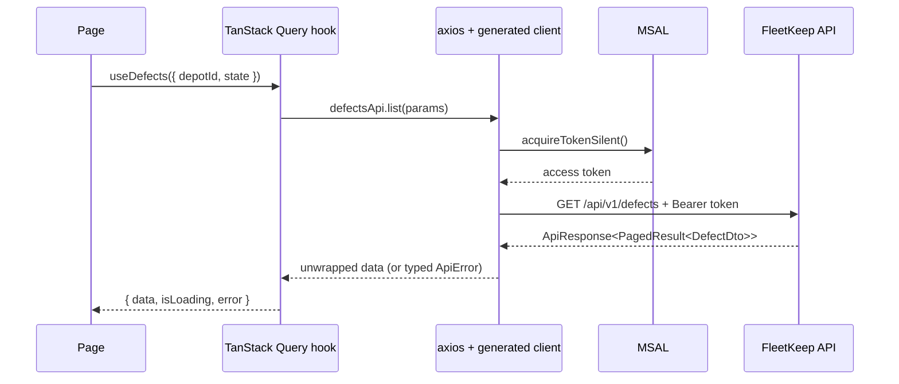

# Frontend Architecture

## Component Hierarchy

Layering is route page → feature component → TanStack Query hook → API client. A lower layer never
imports a higher one, and a shared primitive is extended before a new one is created.



```
src/Web/src/
├── routes/      # one lazy route module per URL; no markup beyond the page mount
├── features/    # a feature owns its pages, components, hooks and tests
│   └── defects/ #   pages/ · components/ · hooks/ · defects.test.tsx
├── components/  # shared presentational components — no data fetching, no feature imports
│   └── layout/  #   AppShell, nav, depot switcher, colour-scheme toggle
├── hooks/       # cross-feature hooks: useTenant, usePermissions, useDebouncedFilter
├── api/         # generated client, axios instance, one query hook per endpoint
├── theme/       # Mantine theme object — the design-token source of truth
└── test/        # Vitest setup, MSW handlers, render helpers
```

A component in `src/components/` importing from `src/features/` is a layering violation and fails
review.

## Routing

React Router v6 with `createBrowserRouter`, declared in `src/Web/src/routes/index.tsx`. Every route
module is `React.lazy`-loaded, so each page is its own chunk.

```
/                  → ComplianceDashboardPage   (protected)
/vehicles          → VehicleListPage           (protected)
/vehicles/:id      → VehicleDetailPage         (protected)
/inspections       → InspectionListPage        (protected)
/checks/new        → WalkaroundCheckPage       (protected, mobile-first)
/defects           → DefectListPage            (protected)
/defects/:id       → DefectDetailPage          (protected)
/jobcards          → JobCardQueuePage          (protected)
/jobcards/:id      → JobCardDetailPage         (protected)
/parts             → PartsStockPage            (protected)
/exports           → AuditExportPage           (protected, role-gated)
/admin/users       → UserAdminPage             (protected, role-gated)
/login             → LoginPage                 (public — MSAL redirect landing)
/forbidden         → ForbiddenPage             (protected)
*                  → NotFoundPage
```

Protection is a single `<RequireAuth>` wrapper using MSAL's `useIsAuthenticated`. An unauthenticated
user is sent to `/login`, which triggers the redirect flow and returns them to the original path.
Role-gated routes additionally check `usePermissions()` and render `/forbidden` rather than
redirecting, so the URL stays shareable and the user understands what happened.

## Data Flow



Query keys are `['resource', tenantId, ...params]` so cached rows can never leak across a tenant
switch. Mutations invalidate by key rather than refetching by hand.

## State Management

| Type | Mechanism |
|------|-----------|
| Auth session / tokens | MSAL (`@azure/msal-react`) — the only owner; never copied into app state |
| Cached server data | TanStack Query v5 (`staleTime` 30s, dashboard `refetchInterval` 60s) |
| Tenant, user, permissions | `TenantContext` — populated once after sign-in from `GET /api/v1/tenancy/me` |
| App-wide UI state | Mantine hooks + `localStorage` (colour scheme, selected depot, table density) |
| Form state | React Hook Form + Zod resolver, local to the form |
| Transient feedback | `@mantine/notifications` |

Rule: reach for TanStack Query first. Adding a global store is justified only when state is shared
by unrelated routes **and** is not server data — which today is only the tenant/session object.

## API Layer

`src/Web/src/api/` holds one module per domain (`vehicles.ts`, `defects.ts`, `jobcards.ts`, …)
generated from the API's OpenAPI document, plus `client.ts`: a single axios instance that sets
`VITE_API_BASE_URL`, attaches the MSAL bearer token in a request interceptor, unwraps
`ApiResponse<T>`, and converts `error` into a typed `ApiError` carrying `code` and `traceId`.

Response interceptor rules: **401** → MSAL sign-out and redirect to `/login`; **403** → throw
`ApiError`, which the page renders inline (no redirect); **5xx** → throw, and the nearest error
boundary shows a retry with the `traceId`. Components never call the client directly — they use a
hook from `src/api/hooks/`.

Regenerate the client with `npm run api:generate` whenever the API contract changes; the generated
files are committed so a build never depends on a running API.

## Real-Time

None. The compliance dashboard polls every 60 seconds and mutations invalidate their keys.
Introducing SignalR would be an ADR — it changes hosting, auth and the offline story.

## Branding / Theming Implementation

Single brand, resolved at build time. `src/Web/src/theme/theme.ts` exports the Mantine theme —
the `brand` colour scale, radius, spacing, fonts and component defaults — and is the authoritative
source that `.ai/standards/project/frontend/design/*` mirrors. Light/dark comes from Mantine's
`ColorSchemeScript` plus a persisted user override. Components read tokens
(`var(--mantine-color-brand-6)`, `theme.radius.md`); a raw hex in a component is a review failure.

## Path Alias

`@` → `src/Web/src`, configured in both `vite.config.ts` (`resolve.alias`) and `tsconfig.json`
(`compilerOptions.paths`). Relative imports are fine inside a feature folder; anything crossing a
folder boundary uses the alias.

```ts
import { useDefects } from '@/api/hooks/useDefects'
import { StatusBadge } from '@/components/StatusBadge'
import { DefectCategoryChip } from './DefectCategoryChip' // same feature — relative is correct
```
